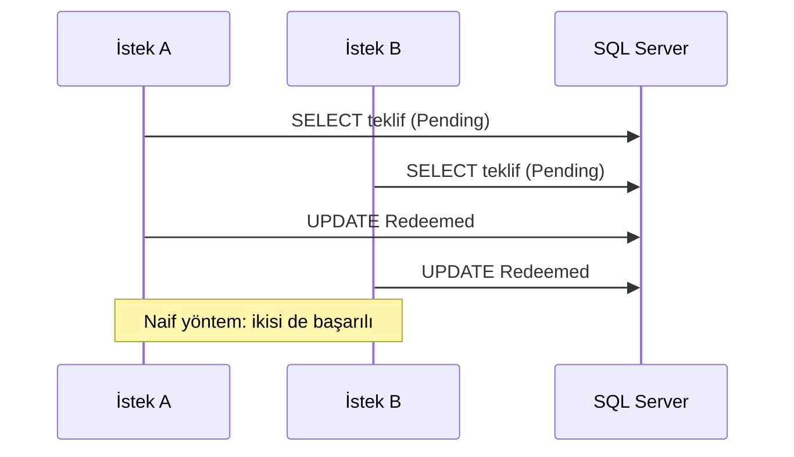

# Bölüm 2: SQL Server, EF Core ve Eşzamanlılık

| | |
|---|---|
| İlan maddeleri | **i** (ORM, Entity Framework), **j** (MSSQL), **f** (ADO.NET), **c** (güvenli yazılım), **b** (doğrulama), tercihen **ii** (unit test) |
| Sonuç | Issuer veri modeli SQL Server'da. Bileşenler: EF Core 10, migration, en az yetkili kullanıcı, Testcontainers ile gerçek veritabanı testleri, aynı sorunun üç eşzamanlılık çözümü |
| PR | https://github.com/sefatuncer/dijital-kimlik-oid4vc/pull/3 |

## 1. Amaç

Issuer, verdiği her kimlik bilgisini, teklifi (credential offer) ve durum listesini saklar.
Bu bölümde dört şey kuruldu:

- geliştirme veritabanı
- veri erişim katmanı
- veritabanı kullanıcılarının yetkileri
- gerçek SQL Server'a karşı koşan testler

Bölümün ikinci yarısı tek bir soruya ayrıldı: aynı teklif aynı anda iki kez kullanılmak
istenirse ne olur?

## 2. Geliştirme veritabanı

| Dosya | Görev |
|---|---|
| `deploy/docker-compose.dev.yml` | SQL Server 2022 (`dk-mssql`). Port yalnız `127.0.0.1`'e açık, veri adlandırılmış volume'da, sağlık denetimi `sqlcmd -Q "SELECT 1"` |
| `deploy/dev.local.env.example` | Parola değişkenlerinin adları. Gerçek dosya (`dev.local.env`) `.gitignore`'da |
| `scripts/dev-veritabani.ps1` | Konteyneri başlatır, sağlıklı olmasını bekler, migration'ları uygular, `db/00` betiğini `sqlcmd -v` ile çalıştırır, bağlantı dizesini user-secrets'a yazar |
| `db/00-uygulama-kullanicilari.sql` | `dk_issuer_app` kullanıcısı: `issuer` şemasında yalnız `SELECT/INSERT/UPDATE/DELETE/EXECUTE`, `audit` şemasında yalnız `SELECT` |

```powershell
. .\scripts\ortam.ps1          # SDK'yı bu oturumun PATH'ine ekler
.\scripts\dev-veritabani.ps1   # konteyner + migration + kullanıcı + user-secrets
```

**Neden en az yetki?** Migration'ları yönetici hesabı uygular. Uygulama ise tablo silemeyen ve
şema değiştiremeyen ayrı bir login ile bağlanır. SQL injection olsa bile zarar sınırlı kalır.
Bölüm 3'teki test bunu kanıtlıyor: uygulama kullanıcısı `DROP TABLE` denediğinde 3701 hatası,
audit tablosuna `INSERT` denediğinde 229 hatası alıyor.

## 3. EF Core katmanı

| Yol | İçerik |
|---|---|
| `Persistence/IssuerDbContext.cs` | Varsayılan şema `issuer`, `EnableRetryOnFailure(3, 5 sn)`, `IUnitOfWork` |
| `Persistence/Configurations/*.cs` | Fluent API: tablo/sütun tipleri, unique ve filtreli indeksler, `rowversion`, check constraint |
| `Persistence/Migrations/..._InitialIssuer.cs` | İlk şema |
| `Persistence/DesignTimeIssuerDbContextFactory.cs` | `dotnet ef` araçları için bağlam (uygulamayı çalıştırmadan) |
| `Persistence/SqlServerErrors.cs` | 2601/2627 numaralı hataları `UniqueConstraintException`'a çevirir. Application katmanı SQL Server'ı tanımaz |
| `Persistence/IssuerDevelopmentSeeder.cs` | Geliştirme verisi. Yalnız Development ortamında, tekrar çalışınca çoğaltmaz |
| `DependencyInjection.cs` | `AddIssuerInfrastructure`: DbContext Scoped. Bağlantı dizesi kodda ve appsettings'te yok |

Migration'ı oluşturma ve inceleme:

```powershell
dotnet ef migrations add InitialIssuer -p src/DijitalKimlik.Infrastructure -s src/DijitalKimlik.Infrastructure
dotnet ef migrations script --idempotent -p src/DijitalKimlik.Infrastructure -s src/DijitalKimlik.Infrastructure
```

**Canlıda migration'ı kim uygular?** Uygulama açılırken `Migrate()` çağırmak kolaydır ama
canlıda yanlıştır. Üç nedeni var:

- Uygulama hesabının DDL yetkisi olur.
- Birden çok sunucu aynı anda migration'a girer.
- Değişiklik DBA onayından geçmez.

Bu projede iki dağıtım artefaktı CI'da üretiliyor. Biri DBA'ya verilen idempotent SQL betiği,
diğeri migration bundle. İkisinin provası da Bölüm 3'te CI'a eklendi.

## 4. Testler: gerçek SQL Server

`tests/DijitalKimlik.IntegrationTests/Infrastructure/SqlServerFixture.cs` testlere gerçek bir
veritabanı sağlar:

- Testcontainers ile her test çalıştırmasında **geçici bir SQL Server konteyneri** açar.
- Migration'ları uygular.
- Bütün sınıflar tek bir xUnit koleksiyonunda bu konteyneri paylaşır.

In-memory sağlayıcı kullanılmadı. Nedeni: unique indeks, `rowversion`, transaction ve kilit
davranışını taklit etmez. Bu bölümün konusu tam da bunlar.

## 5. Aynı sorun, üç çözüm: teklifin bir kez kullanılması

Senaryo şöyle:

- Cüzdan, ön yetkili kodu (pre-authorized code) ve PIN'i gönderip teklifi kullanır.
- Kod tek kullanımlıktır.
- Beş yanlış PIN teklifi kilitler.

Aynı kod aynı anda on istekle gelirse yalnız biri başarılı olmalıdır.



| Yöntem | Dosya (`Persistence/Offers/`) | Nasıl | Bedeli |
|---|---|---|---|
| İyimser | `OptimisticOfferRedeemer.cs` | `rowversion` + `DbUpdateConcurrencyException` olunca yeniden dene (en çok `MaxTxCodeAttempts + 1` kez) | Çakışma çoksa yeniden deneme maliyeti |
| Kötümser | `PessimisticOfferRedeemer.cs` | `FromSql(... WITH (UPDLOCK, ROWLOCK))`, `CreateExecutionStrategy().ExecuteAsync` içinde transaction | Kilit bekleme; retry stratejisiyle kullanıcı transaction'ı ancak bu yolla birleşir |
| Atomik | `AtomicOfferRedeemer.cs` | Koşullu `ExecuteUpdateAsync`. Karar `WHERE`'de, tek komut | EF `OUTPUT` döndürmez; sonucu ayrıca okumak gerekir |

Seçim yapılandırmadan yapılır (`Persistence:OfferRedemptionStrategy`). Yöntemlerin dördü de
keyed service olarak kayıtlı. Dördüncü yöntem, saklı yordam, Bölüm 3'te eklendi.

`OfferRedemptionConcurrencyTests.cs` her yöntem için şunları kanıtlar:

- 10 paralel doğru PIN: tam olarak 1 Success ve 9 AlreadyRedeemed.
- 10 paralel yanlış PIN: `FailedTxCodeAttempts == 5`, durum Locked.
- Süresi geçmiş teklif kullanılamaz. Bilinmeyen kod `null` döner.
- Naif "oku-kontrol et-yaz" yöntemiyle 10 isteğin 10'u da başarılı olur. Hata bu testle
  görünür kılınır.

Paralel istekler bir `TaskCompletionSource` kapısında bekletilip aynı anda bırakılır. Bunu
yapmazsan görevler sırayla başlar ve yarış hiç oluşmaz.

## 6. Çıkan sorunlar ve dersler

| Sorun | Neden | Çözüm |
|---|---|---|
| `GetValue` yok (CS1061) | `IConfiguration.GetValue` uzantısı ayrı pakette | `Microsoft.Extensions.Configuration.Binder` |
| Kötümser yöntemde "user-initiated transactions not supported" | `EnableRetryOnFailure` açıkken elle transaction | Transaction'ı `CreateExecutionStrategy().ExecuteAsync` içine almak |
| Duman testi "Expected 1, Actual 3" | Seeder "herhangi bir StatusList var mı" diye bakıyordu; başka testler de liste ekliyordu | Seed işareti belirli bir kayda bağlandı, test o kaydı doğruluyor |
| Atomik yöntemde yanlış PIN sayısı tam 4 değil | `ExecuteUpdate` sonucu döndürmüyor; okuma ile güncelleme arasında başka istek araya giriyor | Test "en çok 4" diyor. Kesin sonuç için Bölüm 3'teki SP `OUTPUT` kullanıyor |

## 7. Mülakat notları

- "EF Core'da eşzamanlılığı nasıl yönetirsin?" sorusuna cevap: üç yöntem, her birinin
  bedeli ve bu projedeki testler.
- "Neden in-memory test değil?" sorusuna cevap: kısıt, kilit ve transaction davranışı.
- "Migration'ı canlıya nasıl alırsın?" sorusuna cevap: idempotent betik veya bundle, DBA onayı,
  uygulama hesabında DDL yetkisi yok.
- "En az yetki ilkesini nasıl uyguladın?" sorusuna cevap: `db/00` betiği ve testteki 229 ve
  3701 hataları.
