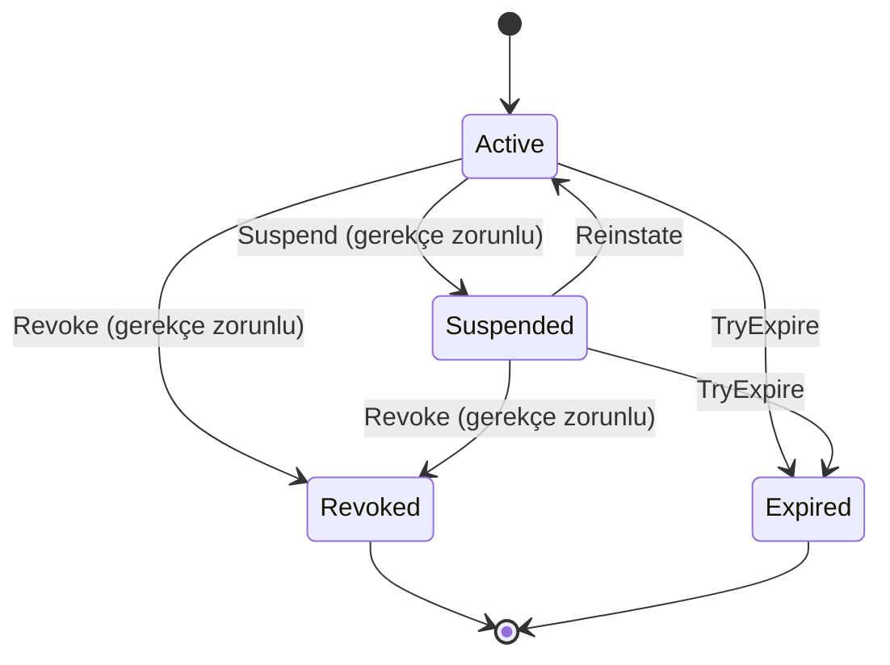

# Geliştirme Notu 1: Çözüm İskeleti, Çok Katmanlı Mimari ve Domain Modeli

| | |
|---|---|
| Kapsam | Çözüm yapısı, katmanlı mimari, domain modeli, birim testleri, CI |
| Sonuç | 11 projelik çözüm, iş kurallarını taşıyan Domain, ilk use-case, 35 test, GitHub Actions CI, korumalı `main` dalı |
| PR | https://github.com/sefatuncer/dijital-kimlik-oid4vc/pull/1 |

## 1. Amaç

Bu notta uygulamanın omurgasını kurduk. Üç soruya cevap verdik:

- Hangi katman ne yapar?
- Hangi proje hangisini kullanabilir (bağımlılık yönü)?
- İş kuralları nerede yaşar?

Bu kararları sonradan değiştirmek en pahalısıdır, çünkü bütün kod bunların üzerine kurulur.

## 2. Mimari

### 2.1 Katmanlar ve bağımlılık yönü

Önce terimler:

- **Katman:** Aynı tür işi yapan kodun bir araya toplandığı bölüm. Her katman ayrı bir projedir
  (ayrı DLL).
- **Bağımlılık:** A projesi B'yi kullanıyorsa (proje referansı varsa) A, B'ye bağımlıdır. B
  değişirse A etkilenebilir. Tersi geçerli değildir.
- **Use-case:** Kullanıcının sistemde yaptığı bir iş: "yabancı kaydet", "kimlik bilgisi ver".
- **Arayüz (interface):** Bir işin *ne* yapacağını söyleyen, *nasıl* yapacağını söylemeyen sözleşme.
  Örnek: `IForeignerRepository` "yabancıyı kaydet" der, SQL Server'ı bilmez.

Aşağıdaki şekilde her kutu bir katman, her ok "şuna bağımlı" demektir:

```text
            ┌────────────────────────────────────────────┐
            │  Sunum: Issuer, Wallet, Verifier (MVC+API) │
            │  Worker (Windows servisi), LegacySoap      │
            └───────────────┬───────────────┬────────────┘
                            │               │ (yalnız DI kaydı için)
                            ▼               ▼
            ┌───────────────────────┐   ┌──────────────────────────┐
            │ Application           │◄──│ Infrastructure           │
            │ use-case, arayüzler   │   │ EF Core, ADO.NET, Redis  │
            └───────┬───────────┬───┘   └──────────────────────────┘
                    ▼           ▼
            ┌────────────┐ ┌────────────┐
            │ Domain     │ │ Crypto     │
            │ iş kuralı  │ │ SD-JWT,JWS │
            └────────────┘ └────────────┘
```

Kural: **oklar içe doğru**.

- Domain hiçbir projeye bağlı değildir. İçinde yalnız iş kuralları vardır: "bir yabancının aynı
  türde iki aktif izni olamaz" gibi.
- Application, Domain'e bağlıdır. İş akışını yönetir ve ihtiyaç duyduğu arayüzleri tanımlar.
- Infrastructure, Application'daki arayüzleri *uygular*. Veritabanına gerçekten yazan kod buradadır.
  Bu yüzden ok Infrastructure'dan Application'a gider, tersi değil.

Buna **bağımlılığın tersine çevrilmesi** (Dependency Inversion) denir. Normalde iş kodu veritabanı
kodunu çağırır ve ona bağımlı olur. Burada iş kodu yalnız arayüzü bilir; veritabanı kodu o arayüze
uyar. Çalışma anında hangi uygulamanın kullanılacağını **DI** (dependency injection, bağımlılık
enjeksiyonu) belirler. DI, bir sınıfın ihtiyaç duyduğu nesneleri kendisinin oluşturmaması,
dışarıdan (genelde yapıcı metot üzerinden) almasıdır. Ne işe yarar:

- Veritabanını SQL Server'dan PostgreSQL'e çevirmek yalnız Infrastructure'ı etkiler.
- İş kuralı, veritabanı olmadan, sahte bir repository ile test edilir.

Şekildeki öteki adlar: **SD-JWT** ve **JWS** kimlik bilgisinin imzalı veri biçimleridir (Not 4).
**Redis** bellek içi önbellektir. **MVC** ASP.NET Core'un web arayüzü modelidir.

### 2.2 Klasik N-katmanlı mimari ile farkı

Klasik 3 katmanlı yapıda sıra şöyledir: Sunum → İş → Veri Erişimi. İş katmanı veri katmanına
bağımlıdır. Sonuçları:

- İş kuralları dolaylı olarak veritabanı teknolojisine bağlanır.
- İş kuralını test etmek için veritabanı gerekir.

Bu projedeki yapı **Clean Architecture** ya da **Onion (soğan) mimarisi** ailesindendir. İş kuralları
merkezdedir, teknoloji (veritabanı, web, dosya) dış halkadadır. İkisi de "çok katmanlıdır". Fark,
bağımlılığın yönündedir: klasikte iş, veriye bağlı; burada veri, işe bağlı.

### 2.3 Projeler

"Şablon" sütunu, projeyi oluşturan `dotnet new` şablonudur: `classlib` sınıf kütüphanesi (DLL),
`mvc` web uygulaması, `web` boş web uygulaması, `worker` arka plan servisi, `xunit` test projesi.

| Proje | Şablon | Görev |
|---|---|---|
| `DijitalKimlik.Domain` | classlib | Entity, value object, durum makinesi, iş kuralı. Bağımlılık yok |
| `DijitalKimlik.Application` | classlib | Use-case servisleri, repository arayüzleri, Result |
| `DijitalKimlik.Crypto` | classlib | İmza ve kimlik bilgisi biçimleri: JWS, SD-JWT, Status List (Not 4) |
| `DijitalKimlik.Infrastructure` | classlib | Dış dünyayla konuşan kod: EF Core, ADO.NET, Redis (Not 2'den itibaren) |
| `DijitalKimlik.Issuer` | mvc | Kimlik bilgisini veren taraf: OpenID4VCI API ve memur portalı |
| `DijitalKimlik.Wallet` | mvc | Kimlik bilgisini saklayan web cüzdanı |
| `DijitalKimlik.Verifier` | mvc | Kimlik bilgisini doğrulayan taraf: OpenID4VP API ve doğrulayıcı portalı |
| `DijitalKimlik.LegacySoap` | web | Eski sistemi taklit eden SOAP servisi. CoreWCF, WCF'nin .NET 5+ için açık kaynak sürümüdür |
| `DijitalKimlik.Worker` | worker | Windows servisi: zamanlanmış arka plan işleri |
| `DijitalKimlik.UnitTests` | xunit | Domain ve Application testleri |
| `DijitalKimlik.IntegrationTests` | xunit | Uygulamayı bellek içinde ayağa kaldıran testler |

## 3. Adım adım

Aşağıdaki komutlar çözümü sıfırdan kurar. Her satırın ne yaptığı yorumda yazıyor.

```powershell
. .\scripts\ortam.ps1                                 # SDK'yı bu oturumda etkinleştir (Not 0)
dotnet new sln -n DijitalKimlik                       # çözüm dosyası. .NET 10'da DijitalKimlik.slnx üretir
dotnet new classlib -o src/DijitalKimlik.Domain        # Application, Crypto, Infrastructure aynı şekilde
dotnet new mvc      -o src/DijitalKimlik.Issuer        # Wallet, Verifier aynı şekilde
dotnet new web      -o src/DijitalKimlik.LegacySoap
dotnet new worker   -o src/DijitalKimlik.Worker
dotnet new xunit    -o tests/DijitalKimlik.UnitTests   # IntegrationTests aynı şekilde

# Bütün projeleri çözüme ekle. --solution-folder, projeyi çözümde src/ veya tests/ klasörüne koyar
Get-ChildItem src,tests -Recurse -Filter *.csproj | ForEach-Object {
    dotnet sln add $_.FullName --solution-folder $_.Directory.Parent.Name }

# Bağımlılık yönünü proje referanslarıyla kur. "A reference B" = A, B'yi kullanabilir
dotnet add src/DijitalKimlik.Application reference src/DijitalKimlik.Domain src/DijitalKimlik.Crypto
dotnet add src/DijitalKimlik.Infrastructure reference src/DijitalKimlik.Application
dotnet add src/DijitalKimlik.Issuer reference src/DijitalKimlik.Application src/DijitalKimlik.Infrastructure

# Paket ekle. Merkezi paket yönetimi açık olduğu için sürüm Directory.Packages.props'a yazılır
dotnet add tests/DijitalKimlik.UnitTests package Microsoft.Extensions.TimeProvider.Testing

dotnet build      # bütün projeleri derle
dotnet test       # bütün testleri çalıştır
```

Sonuç: `dotnet build` 0 uyarı ve 0 hata verdi. `dotnet test` 35 testin 35'ini geçti.

**`.slnx`:** Çözüm dosyası, hangi projelerin birlikte açılacağını listeler. .NET 10 SDK, `dotnet new
sln` ile eski `.sln` yerine XML tabanlı `.slnx` üretir. Eski biçim GUID'lerle doluydu. İki kişi aynı
anda proje ekleyince Git'te birleştirme çakışması sık çıkardı. Yeni biçim kısa ve okunaklıdır.
Güncel Visual Studio ve VS Code (C# Dev Kit eklentisiyle) ikisini de açar. Eski bir IDE için
`dotnet sln migrate` komutu dönüşüm yapar.

**Portlar:** Yerel geliştirmede uygulamalar yalnız HTTP ile açılır: Issuer `5101`, Wallet `5201`,
Verifier `5301`, LegacySoap `5401`. Üretim ayarında HTTPS ve HSTS açıktır (Not 12). HSTS (HTTP
Strict Transport Security), tarayıcıya "bu siteye bundan sonra yalnız HTTPS ile gel" diyen
yanıt başlığıdır.

## 4. Domain modeli

Domain modeli, iş dünyasındaki kavramların (yabancı, ikamet izni, kimlik bilgisi, teklif) kodda
karşılığıdır. Kurallar bu sınıfların içinde durur, servislere dağılmaz.

### 4.1 Yabancı kimlik numarası (value object)

`src/DijitalKimlik.Domain/Foreigners/ForeignerIdentityNumber.cs`

Yabancı kimlik numarası 11 hanelidir ve 99 ile başlar. Son iki hane **kontrol hanesidir**: yanlış
yazılmış bir numarayı yakalamak için ilk dokuz haneden hesaplanır. Algoritma T.C. kimlik
numarasındakiyle aynıdır:

- 10. hane = ((1., 3., 5., 7., 9. hanelerin toplamı) × 7 − (2., 4., 6., 8. hanelerin toplamı)) mod 10
- 11. hane = (ilk 10 hanenin toplamı) mod 10

Örnek, ilk dokuz hanesi `991234567` olan numara:

1. Tek sıradaki haneler: 9 + 1 + 3 + 5 + 7 = 25.
2. Çift sıradaki haneler: 9 + 2 + 4 + 6 = 21.
3. 10. hane: (25 × 7 − 21) mod 10 = 154 mod 10 = **4**.
4. 11. hane: 9+9+1+2+3+4+5+6+7+4 = 50, 50 mod 10 = **0**.

Sonuç: `99123456740`.

Bu sınıf bir **value object**'tir (değer nesnesi). Value object, kimliği olmayan ve yalnız değeriyle
anlam taşıyan nesnedir. Para tutarı, adres ve kimlik numarası örnektir. Üç özelliği var:

- **Değeriyle karşılaştırılır.** Aynı haneleri taşıyan iki nesne eşittir. C#'ta `record` türü bu
  eşitliği kendiliğinden sağlar.
- **Değişmezdir (immutable).** Oluştuktan sonra değeri değiştirilemez. Başka bir değer gerekiyorsa
  yeni nesne oluşturulur.
- **Geçersiz hâli oluşturulamaz.** Yapıcı metot `private`'tır. Nesne yalnız `Create`/`TryCreate`
  metotlarıyla ve doğrulamadan geçerek oluşur. Ne işe yarar: numarayı kullanan hiçbir kodun onu
  yeniden doğrulaması gerekmez. Elinde bu tür bir nesne varsa numara geçerlidir.

Dikkat: C#'ta `%` (kalan) işleci negatif sonuç verebilir: `-3 % 10 == -3`. Oysa kontrol hanesi 0–9
olmalıdır. Kodda `((x % 10) + 10) % 10` yazılarak sonuç 0–9 aralığına çekilir. Sık yapılan
bir hatadır.

### 4.2 Yabancı ve ikamet izni (aggregate)

**Entity** (varlık), kimliği olan nesnedir. Özellikleri değişse de aynı nesne kalır: adı düzeltilen
yabancı yine aynı kişidir. **Aggregate**, birlikte tutarlı kalması gereken entity'lerin grubudur.
Grubun dışarıya açılan tek kapısına **aggregate root** (kök) denir.

Bu projede `Foreigner` (yabancı) bir aggregate root'tur. İkamet izinleri onun parçasıdır:

- İzin yalnız `foreigner.GrantPermit(...)` metoduyla eklenir.
- İzin listesi dışarıya `IReadOnlyCollection` olarak açılır: okunabilir, değiştirilemez. Kimse
  listeye doğrudan `permits.Add(...)` yapamaz.

Ne işe yarar: "aynı türde çakışan iki aktif izin olamaz" kuralı tek yerde, `GrantPermit` içinde
denetlenir. Kuralı atlatacak başka bir yol yoktur.

EF Core için her entity'de parametresiz `private` bir yapıcı var. EF, nesneyi veritabanından okurken
onu kullanır. Uygulama kodu ise yalnız kuralları denetleyen `public` yapıcıyı çağırabilir.

### 4.3 Kimlik bilgisinin durum makinesi

`src/DijitalKimlik.Domain/Credentials/IssuedCredential.cs`

**Durum makinesi** (state machine), bir nesnenin hangi durumlarda olabileceğini ve hangi durumdan
hangisine geçebileceğini tanımlayan modeldir. Verilmiş bir kimlik bilgisinin dört durumu var:

- **Active:** geçerli.
- **Suspended:** askıda. Geçici olarak kullanılamaz, örneğin inceleme sürerken.
- **Revoked:** iptal edildi. Geri dönüşü yok.
- **Expired:** süresi doldu. Geri dönüşü yok.



Geçişler koddaki bir tabloda (`AllowedTransitions`) tanımlı. Tabloda olmayan bir geçiş, örneğin
Revoked → Active, `DomainException` fırlatır. İptal ve askıya alma için gerekçe yazmak zorunludur.

`StatusListValue`, **Token Status List**'e yazılacak değeri verir. Status List, verilmiş kimlik
bilgilerinin geçerli olup olmadığını doğrulayıcıya bildiren, sıkıştırılmış bir bit listesidir
(Not 4). Değerler: 0 geçerli, 1 geçersiz (iptal ya da süresi dolmuş), 2 askıda.

**Veri minimizasyonu (KVKK):** Kurum, verdiği kimlik bilgisinin (SD-JWT) kendisini saklamaz. Yalnız
iptal ve denetim için gereken üst veriyi tutar: kime, ne zaman, hangi durumda. Saklanmayan veri
sızdırılamaz.

### 4.4 Teklif: PIN denemesi ve özet saklama

`src/DijitalKimlik.Domain/Offers/CredentialOffer.cs`

**Teklif** (credential offer), memurun yabancıya "kimlik bilgin hazır, cüzdanına al" dediği tek
kullanımlık davettir. Cüzdan teklifi iki değerle kullanır: **ön yetkili kod** (pre-authorized code,
uzun ve rastgele bir metin) ve yabancıya ayrıca verilen 6 haneli **PIN**.

- Kod ve PIN **düz metin saklanmaz**. Yalnız **SHA-256 özetleri** saklanır. Özet (hash), veriden
  üretilen ve geri çevrilemeyen sabit uzunlukta bir parmak izidir. Veritabanı çalınsa bile kodlar
  okunamaz.
- 6 haneli PIN'in tek başına özeti kolayca bulunur. Yalnız 10⁶ (bir milyon) olasılık vardır;
  saldırgan hepsini dener (kaba kuvvet). Bu yüzden PIN, tahmin edilemez kodla birlikte özetlenir:
  `SHA-256(kod + ":" + PIN)`. Kodu bilmeyen PIN'i deneyemez.
- Karşılaştırma `CryptographicOperations.FixedTimeEquals` ile yapılır. Normal `==` ilk farklı
  baytta durur. Saldırgan yanıt sürelerini ölçerek kaç baytın doğru olduğunu tahmin edebilir. Buna
  **zamanlama saldırısı** (timing attack) denir. `FixedTimeEquals` her zaman bütün baytları
  karşılaştırır, süre girdiden bağımsız olur.
- Beş yanlış PIN denemesinden sonra teklif kilitlenir. Kilitli teklife doğru PIN girilse de sonuç
  değişmez. Bunu bir test doğruluyor.

### 4.5 Id seçimi: int mi, GUID mi?

İç kimlikler `int IDENTITY`'dir: veritabanının 1, 2, 3 diye artırdığı sayı. Neden rastgele GUID
değil?

- Tablo, **clustered index**'e göre diskte sıralı saklanır. Clustered index, satırların fiziksel
  sırasını belirleyen indekstir; burada Id sütunudur.
- Artan sayı her zaman sona eklenir. Rastgele GUID ise her eklemede sıranın ortasına bir yere
  düşer. Dolu bir sayfanın ortasına yer açmak için sayfa ikiye bölünür. Buna **page split** denir.
  Sonuçta indeks parçalanır (fragmentation): sayfalar yarı boş ve dağınık olur, okuma yavaşlar.
- GUID 16 bayttır, `int` 4 bayt. Bütün indeksler bu değeri taşıdığı için fark büyür.

Dışarıya açılan kimlikler ise ayrıdır ve tahmin edilemez: `PublicId` GUID'i ve `urn:uuid:` kimliği.
Neden: URL'de sıralı Id kullanılırsa saldırgan `/offers/1`, `/offers/2` diye deneyerek başkasının
kaydına ulaşabilir. Buna **IDOR** (Insecure Direct Object Reference, güvensiz doğrudan nesne
erişimi) denir.

## 5. Application katmanı

### 5.1 Result deseni

`src/DijitalKimlik.Application/Common/Result.cs`

İki tür hata vardır:

- **Beklenen hata:** iş akışının normal bir sonucudur. Örnek: kayıt zaten var, numara geçersiz.
  Bunlar **dönüş değeriyle** bildirilir: metot `Result<int>` döner. Başarılıysa içinde değer, değilse
  hata kodu ve mesajı vardır.
- **Beklenmeyen hata:** programın devam edemeyeceği durumdur. Örnek: veritabanı kapalı. Bunlar
  exception olarak fırlatılır.

Gerekçe:

- Hata yolu metot imzasında görünür. Çağıran kod, sonucun başarısız olabileceğini imzadan anlar.
- Exception pahalıdır. Fırlatılırken çağrı yığını (stack trace) toplanır.
- Akışı exception ile yönetmek okunurluğu düşürür. `try/catch` blokları iş mantığını gizler.

Kullanımı:

```csharp
// Kayıt başarısız olabilir: sonuç Result<int> olarak döner
Result<int> sonuc = await foreignerService.RegisterAsync(komut, ct);
if (!sonuc.IsSuccess)
{
    return BadRequest(sonuc.Error!.Message);   // beklenen hata: kullanıcıya mesaj
}

return Ok(sonuc.Value);                         // yeni kaydın Id'si
```

Sonuç: hata durumunda exception yok, kullanıcı "Bu kimlik numarasıyla kayıt zaten var" gibi bir
mesaj görür.

### 5.2 Use-case servisi ve bağımlılıklar

`ForeignerService` üç bağımlılığı yapıcı metot üzerinden alır. C# 12'nin **primary constructor**
yazımı kullanılıyor: parametreler doğrudan sınıf adının yanına yazılır.

- `IForeignerRepository`: yabancıyı okuyup ekleyen arayüz.
- `IUnitOfWork`: değişiklikleri tek seferde kaydeden arayüz (`SaveChangesAsync`).
- `TimeProvider`: "şu an saat kaç?" sorusunun cevabı.

**`TimeProvider`** .NET 8 ile geldi. `DateTime.Now`'ın test edilebilir hâlidir. Kod saati doğrudan
sistemden okursa "teklifin süresi 10 dakika sonra dolar" kuralı test edilemez; 10 dakika beklemek
gerekir. Testte `FakeTimeProvider` kullanılır ve saat elle ileri alınır.

**Kontrol et sonra yap (check-then-act) yarışı:** Servis kayıttan önce "bu numarayla kayıt var mı?"
diye bakar. Bu kontrol, kullanıcıya düzgün bir mesaj vermek içindir. Ama iki istek aynı anda gelirse
ikisi de kontrolü geçebilir: ikisi de "yok" cevabını alır, ikisi de ekler. Asıl güvence veritabanındaki
**unique index**'tir: aynı değerden ikincisinin yazılmasını veritabanı reddeder (Not 2).

### 5.3 DI ömürleri

DI kapsayıcısı (container), bir nesneyi her istendiğinde yeniden mi oluşturacağını yoksa var olanı mı
vereceğini **ömür** (lifetime) ayarına göre belirler. `DependencyInjection.AddApplication()` metodu
servisleri şu ömürlerle kaydeder:

| Ömür | Anlamı | Burada |
|---|---|---|
| Singleton | Uygulama boyunca tek örnek | `TimeProvider.System` |
| Scoped | Her HTTP isteği için bir örnek | `ForeignerService`, ileride `DbContext` |
| Transient | Her istendiğinde yeni örnek | Durumsuz, hafif yardımcılar |

**Captive dependency** (tutsak bağımlılık): Singleton bir servis, Scoped bir servisi yapıcıdan alırsa
Scoped servis fiilen singleton olur. Uygulama boyunca aynı nesne kullanılır. `DbContext` için bu
tehlikelidir: istekler arasında paylaşılır, oysa `DbContext` aynı anda birden çok iş parçacığından
kullanılmaya uygun değildir (thread-safe değildir). Sonuç: rastgele hatalar ve yanlış veri.
ASP.NET Core, Development ortamında `ValidateScopes` ayarıyla bu hatayı uygulama açılırken yakalar.
Windows servisinde (Not 11) bu hatayı bilerek üretip çözeceğiz.

## 6. Testler

| Dosya | Ne test ediliyor |
|---|---|
| `Domain/ForeignerIdentityNumberTests.cs` | Geçerli ve geçersiz numaralar. `Theory` + `InlineData` ile aynı test farklı girdilerle koşar. Elle hesaplanan kontrol hanesi |
| `Domain/ForeignerTests.cs` | Yaş hesabı (doğum günü, artık yıl), çakışan izin kuralı |
| `Domain/IssuedCredentialTests.cs` | Durum makinesi geçişleri, son durumlar, zorunlu gerekçe, süre dolumu |
| `Domain/CredentialOfferTests.cs` | Tek kullanımlık kod, 5 yanlış denemede kilit, süre aşımı |
| `Application/ForeignerServiceTests.cs` | Kayıt, mükerrer kayıt, Domain hatasının Result'a dönüşmesi |
| `IntegrationTests/IssuerSmokeTests.cs` | Issuer uygulaması bellek içinde açılıyor, ana sayfa 200 dönüyor |

Testler **AAA** düzeninde yazıldı: Arrange (hazırla), Act (çalıştır), Assert (doğrula).

Mock kütüphanesi yerine elle yazılmış **fake** nesneler kullanıldı. Fake, gerçeğinin basit ama
çalışan bir kopyasıdır. Örneğin `FakeForeignerRepository` veriyi veritabanı yerine bir listede tutar.
Bağımlılık az olduğunda fake daha okunaklıdır ve dış kütüphane riski taşımaz.

Ortak test verisi `TestData` sınıfında kurulur. Bu, **Object Mother** desenidir: testlerde
kullanılacak hazır nesneleri ("geçerli bir yabancı", "süresi dolmuş bir teklif") tek bir yerden
veren sınıf. Ne işe yarar: bir entity'ye yeni zorunlu alan eklenince yalnız bu sınıf değişir.

Çıktı:

```text
Başarılı!  - Başarısız: 0, Başarılı: 34, Toplam: 34 - DijitalKimlik.UnitTests.dll
Başarılı!  - Başarısız: 0, Başarılı:  1, Toplam:  1 - DijitalKimlik.IntegrationTests.dll
```

## 7. CI ve dal koruması

**CI** (Continuous Integration, sürekli entegrasyon), her değişikliğin paylaşılmadan önce otomatik
olarak derlenip test edilmesidir. `.github/workflows/ci.yml` dosyası GitHub Actions'a ne
yapacağını söyler. Her PR'da ve `main`'e her push'ta şu adımlar çalışır:

1. Kodu al (checkout).
2. `global.json`'daki SDK'yı kur.
3. `dotnet restore`: NuGet paketlerini indir.
4. `dotnet build -c Release`: üretim ayarıyla derle. Uyarılar hata sayılır.
5. `dotnet format --verify-no-changes`: kod biçimi kurallara uymuyorsa adım kırmızı olur.
6. `dotnet test`: testleri çalıştır ve **kod kapsamını** ölç. Kod kapsamı (coverage), testlerin
   kodun yüzde kaçını çalıştırdığıdır; ölçümü **coverlet** aracı yapar. Sonuçlar **artifact**
   olarak saklanır. Artifact, CI'ın ürettiği ve sonradan indirilebilen dosyadır.

Faz 3'te ikinci bir iş eklendi: "Veritabanı dağıtım provası" (Not 3).

Kalite ve güvenlik kararları:

- `permissions: contents: read`: İş akışına verilen erişim anahtarı (token) depoyu yalnız okuyabilir.
  Ele geçirilen bir adım depoya yazamaz. Bu, **en az yetki** ilkesidir: her bileşene yalnız işi için
  gereken yetkiyi ver.
- `concurrency`: Aynı dala yeni push gelince eski çalışma iptal edilir. Boşuna sıra beklenmez.
- Action'lar **commit SHA'sına** sabitlendi: `actions/checkout@3d3c42e… # v7.0.1`. Action, CI'da
  çalışan hazır bir adımdır ve başkasının deposundan gelir. Etiket (`v7`) sonradan başka bir commit'e
  taşınabilir. Action deposu ele geçirilirse etiket kötü koda çevrilebilir ve onu kullanan herkesin
  CI'ında çalışır. SHA ise değişmez. Güncellemeyi Dependabot PR olarak önerir.
- **Runner** `ubuntu-24.04`'e sabitlendi. Runner, CI işini çalıştıran sanal makinedir.
  `ubuntu-latest` etiketi habersiz yeni sürüme geçebiliyor.

**Dal koruması (ilk hâli, Faz 1):** PR zorunluydu, `main`'e doğrudan push yoktu. "Derleme ve test"
kontrolü geçmeden birleştirme yapılamıyordu. Yalnız squash merge açıktı.

**Sonradan değişti (Faz 2):** GitHub'ın birleştirme düğmesi commit'e kişisel e-postayı yazdığı için
`main`'e giriş yerelden fast-forward ile yapılıyor (Not 0, 3.6). Şu an `main`'in koruması:

- "Derleme ve test" kontrolü zorunlu. *Strict*: dal `main`'in son hâline göre güncel olmalı.
- Doğrusal geçmiş zorunlu.
- Force push ve dal silme kapalı.
- Kurallar yöneticiye de uygulanıyor (`enforce_admins`).
- PR zorunluluğu kaldırıldı. Her faz yine PR ile incelenir.

`.github/dependabot.yml`: **Dependabot**, kullanılan paketlerin yeni sürümlerini izleyen GitHub
botudur. NuGet paketleri ve GitHub Actions için haftada bir güncelleme PR'ı açar.

## 8. Çıkan sorunlar ve çözümleri

| # | Belirti | Neden | Çözüm |
|---|---|---|---|
| 1 | `error NU1008: ... PackageReference öğeleri Sürüm için bir değer tanımlayamaz` | Test ve Worker şablonları paket sürümünü `.csproj`'ye yazıyor. Merkezi paket yönetimi buna izin vermiyor | Sürümler `Directory.Packages.props`'a taşındı, `.csproj`'lerden silindi |
| 2 | SDK mesajları Türkçe | İşletim sistemi dili Türkçe | Sorun değil. İnternette ararken hata kodunu (NU1008, CS8618) kullanmak yeterli |
| 3 | `dotnet add package` sürümü yanlış gruba ekledi | Komut sürümü her zaman dosyadaki ilk `ItemGroup`'a yazıyor | `Directory.Packages.props`'ta tek ve alfabetik bir `ItemGroup` |
| 4 | `dotnet format`: `ENDOFLINE` hataları | Şablon dosyaları Windows'ta CRLF ile üretildi, `.editorconfig` LF istiyor | `dotnet format` ile otomatik düzeltildi. `.editorconfig`'e `end_of_line = lf` yazıldı ki Windows ve Linux CI aynı sonucu versin |
| 5 | `dotnet format`: `WHITESPACE ... '\n' öğesini ekleyin` | `.editorconfig`'te `dotnet_separate_import_directive_groups = true`: `using` grupları arasında boş satır isteniyor | Otomatik düzeltildi. Yeni kodda kurala uyuluyor |
| 6 | CI uyarısı: *Node.js 20 is deprecated* | `actions/*@v4` sürümleri eski Node.js 20 ile çalışıyor | Yeni ana sürümlere (checkout v7, setup-dotnet v6, upload-artifact v7) geçildi ve SHA'ya sabitlendi |
| 7 | CI notu: *ubuntu-latest will migrate to Ubuntu 26* | `ubuntu-latest` etiketi yeni imaja geçiyor | `runs-on: ubuntu-24.04` |
| 8 | Yaş testi yanlış kurulmuştu | Test yazılırken 2013 doğumlu birinin 2026'da 18 yaşında olduğu varsayılmış. Oysa 13 yaşında | Test sade tarihlerle yeniden yazıldı. Ders: test kodu da koddur; yanlış beklenti yanlış güven verir |
| 9 | (beklenen ama çıkmayan) `WebApplicationFactory<Program>` hatası | Eskiden `Program` sınıfı `internal` olduğu için test projesi onu göremezdi ve `public partial class Program;` eklemek gerekirdi | .NET 10'da ek bir şey gerekmeden derlendi |


## 9. Terimler sözlüğü

| Terim | Ne demek? | Ne işe yarar, nerede geçer? |
|---|---|---|
| AAA | Arrange, Act, Assert: hazırla, çalıştır, doğrula | Test yazım düzeni; 6 |
| Aggregate / aggregate root | Birlikte tutarlı kalan entity grubu / grubun tek kapısı | Kuralı tek yerde korumak (`Foreigner`); 4.2 |
| Artifact (CI) | CI'ın ürettiği, sonradan indirilebilen dosya | Test sonuçları, betikler; 7 |
| Bağımlılığın tersine çevrilmesi | Üst katmanın arayüze, alt katmanın o arayüze bağlanması | Teknolojiyi değiştirilebilir kılar; 2.1 |
| Captive dependency | Uzun ömürlü servisin kısa ömürlüyü tutması | Singleton içinde `DbContext` hatası; 5.3 |
| Check-then-act | Önce kontrol edip sonra yazmak; arada yarış olabilir | Asıl güvence unique index; 5.2 |
| CI | Her değişikliği otomatik derleyip test etmek | GitHub Actions; 7 |
| Clean / Onion Architecture | İş kuralı merkezde, teknoloji dışta olan mimari | Bu projenin yapısı; 2.2 |
| Clustered index | Satırların diskteki sırasını belirleyen indeks | Id seçimi; 4.5 |
| CoreWCF | WCF sunucusunun .NET 5+ için açık kaynak sürümü | LegacySoap projesi; 2.3 |
| Coverlet | .NET kod kapsamı ölçme aracı | CI test adımı; 7 |
| Dependabot | Paket güncellemelerini izleyip PR açan GitHub botu | `dependabot.yml`; 7 |
| DI | Nesnenin bağımlılıklarını dışarıdan alması | Katmanları çalışma anında bağlar; 2.1 |
| DI ömrü | Singleton, Scoped, Transient | Nesnenin ne kadar yaşadığı; 5.3 |
| Durum makinesi | Durumlar ve izinli geçişler modeli | Kimlik bilgisinin durumu; 4.3 |
| Entity | Kimliği olan nesne | Yabancı, izin; 4.2 |
| Fake | Gerçeğinin basit ama çalışan kopyası | Bellek içi repository; 6 |
| `FixedTimeEquals` | Süresi girdiden bağımsız karşılaştırma | Zamanlama saldırısını önler; 4.4 |
| HSTS | Tarayıcıya "yalnız HTTPS kullan" diyen başlık | Üretim ayarı; 3 |
| IDOR | Sıralı Id ile başkasının kaydına erişme açığı | Dışarıda GUID kullanma nedeni; 4.5 |
| Object Mother | Testlere hazır nesne veren sınıf | `TestData`; 6 |
| Özet (hash), SHA-256 | Veriden üretilen, geri çevrilemeyen parmak izi | Kod ve PIN saklama; 4.4 |
| Page split | Dolu sayfanın ortasına ekleme için sayfanın bölünmesi | Rastgele GUID'in bedeli; 4.5 |
| Primary constructor | Parametreleri sınıf adının yanına yazma (C# 12) | `ForeignerService`; 5.2 |
| Repository / Unit of work | Veriye koleksiyon gibi erişim / değişiklikleri tek seferde kaydetme | `IForeignerRepository`, `IUnitOfWork`; 5.2 |
| Result deseni | Beklenen hatayı dönüş değeriyle bildirmek | `Result<T>`; 5.1 |
| Runner | CI işini çalıştıran sanal makine | `ubuntu-24.04`; 7 |
| SHA'ya sabitleme | Action'ı değişmez commit kimliğiyle çağırmak | Tedarik zinciri saldırısına karşı; 7 |
| `.slnx` | .NET 10'un XML tabanlı çözüm dosyası | Çakışmasız, okunaklı; 3 |
| Status List | Kimlik bilgisi geçerlilik durumlarının bit listesi | `StatusListValue`; 4.3 |
| Teklif (credential offer) | Kimlik bilgisini cüzdana almak için tek kullanımlık davet | Kod + PIN; 4.4 |
| `TimeProvider` | Test edilebilir saat | `FakeTimeProvider` ile testte saat ilerletmek; 5.2 |
| Unique index | Aynı değerin iki kez yazılmasını engelleyen indeks | Yarışın asıl çözümü; 5.2 |
| Use-case | Kullanıcının sistemde yaptığı bir iş | Application katmanı; 2.1 |
| Value object | Kimliksiz, değişmez, değeriyle karşılaştırılan nesne | Yabancı kimlik numarası; 4.1 |
| Veri minimizasyonu | Yalnız gereken veriyi saklamak (KVKK) | SD-JWT'nin kendisi saklanmaz; 4.3 |
| Zamanlama saldırısı | Yanıt süresinden gizli değeri tahmin etmek | `FixedTimeEquals` ile önlenir; 4.4 |
