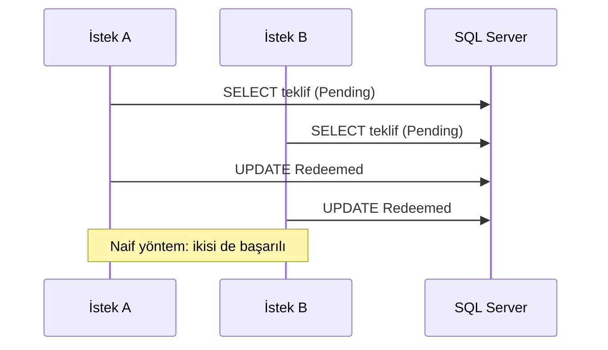

# Geliştirme Notu 2: SQL Server, EF Core ve Eşzamanlılık

| | |
|---|---|
| Kapsam | Veri modeli, EF Core, veritabanı yetkileri, gerçek veritabanıyla entegrasyon testleri, eşzamanlılık denetimi |
| Sonuç | Issuer veri modeli SQL Server'da. EF Core 10, migration, en az yetkili kullanıcı, Testcontainers ile gerçek veritabanı testleri, aynı sorunun üç eşzamanlılık çözümü |
| PR | https://github.com/sefatuncer/dijital-kimlik-oid4vc/pull/3 |

## 1. Amaç

Issuer (kimlik bilgisini veren uygulama) üç tür kayıt saklar:

- verdiği her kimlik bilgisi,
- her teklif (credential offer): yabancının kimlik bilgisini cüzdanına almak için kullandığı tek
  kullanımlık davet,
- durum listeleri (status list): hangi kimlik bilgisinin geçerli, askıda ya da iptal olduğu.

Bu notta dört şey kuruldu:

- geliştirme veritabanı,
- veri erişim katmanı (EF Core),
- veritabanı kullanıcılarının yetkileri,
- gerçek SQL Server'a karşı koşan testler.

Notun ikinci yarısı tek bir soruya ayrıldı: aynı teklif aynı anda iki kez kullanılmak istenirse
ne olur?

> [!NOTE]
> **Senaryo.** Yabancı, cüzdan uygulamasında "Kimlik bilgimi al" düğmesine basar. Bağlantı yavaş
> olduğu için düğmeye hemen bir kez daha basar. Sunucuya aynı teklif için iki istek gelir. İki
> istek de "teklif kullanılmamış" bilgisini okursa ikisi de kimlik bilgisi üretir. Yabancının
> cüzdanında aynı izin için iki ayrı kimlik bilgisi olur ve iptal edilen biri öteki yüzünden
> geçerli görünmeye devam edebilir. 5. kısım bunun nasıl önlendiğini anlatır.

## 2. Geliştirme veritabanı

SQL Server, geliştirici makinesine kurulmaz. **Docker konteynerinde** çalışır. Konteyner,
uygulamayı bağımlılıklarıyla birlikte yalıtılmış olarak çalıştıran hafif bir pakettir. Silinince
makinede iz bırakmaz.

| Dosya | Görev |
|---|---|
| `deploy/docker-compose.dev.yml` | SQL Server 2022 konteynerini (`dk-mssql`) tanımlar. Port yalnız `127.0.0.1`'e açık: ağdaki başka makine bağlanamaz. Veri adlandırılmış bir **volume**'da (konteyner silinse de kalan disk alanı). **Sağlık denetimi** her 5 saniyede `sqlcmd -Q "SELECT 1"` çalıştırır; cevap gelince konteyner "healthy" olur |
| `deploy/dev.local.env.example` | Parola değişkenlerinin yalnız adları. Gerçek değerler `dev.local.env` dosyasındadır ve `.gitignore` sayesinde depoya girmez |
| `scripts/dev-veritabani.ps1` | Kurulumu tek komutla yapar (aşağıda) |
| `db/00-uygulama-kullanicilari.sql` | Uygulamanın bağlanacağı kısıtlı kullanıcıyı (`dk_issuer_app`) oluşturur |

`dev-veritabani.ps1` sırayla şunları yapar:

1. Konteyneri başlatır ve "healthy" olmasını bekler.
2. EF migration'larını uygular, yani tabloları oluşturur.
3. `db/00` betiğini `sqlcmd -v` ile çalıştırır. `-v`, betikteki `$(IssuerAppPassword)` gibi
   değişkenlere değer verir. Böylece parola betiğin içine yazılmaz.
4. Bağlantı dizesini **user-secrets**'a yazar. User-secrets, proje klasörünün dışında, kullanıcı
   profilinde duran gizli ayar dosyasıdır. Bağlantı dizesi hiçbir zaman depoya girmez.

```powershell
. .\scripts\ortam.ps1          # SDK'yı bu oturumun PATH'ine ekler
.\scripts\dev-veritabani.ps1   # konteyner + migration + kullanıcı + user-secrets
```

Sonuç: `dk-mssql` konteyneri çalışır, `DijitalKimlik` veritabanı ve `dk_issuer_app` kullanıcısı
hazırdır. Uygulama ek ayar yapmadan bağlanır.

### En az yetki

SQL Server'da iki ayrı kavram var. **Login**, sunucuya giriş hesabıdır. **User**, o login'in belirli
bir veritabanındaki karşılığıdır. Yetkiler user'a verilir. **Şema** (schema), tabloları gruplayan
klasör gibidir. Bu projede `issuer` şeması iş tablolarını, `audit` şeması denetim kayıtlarını tutar.

| Kim | Ne yapabilir |
|---|---|
| Yönetici hesabı | Migration uygular: tablo oluşturur, değiştirir |
| `dk_issuer_app` | `issuer` şemasında yalnız `SELECT`, `INSERT`, `UPDATE`, `DELETE`, `EXECUTE`. `audit` şemasında yalnız `SELECT` |

Neden: uygulamada bir **SQL injection** açığı çıksa bile zarar sınırlı kalır. SQL injection,
kullanıcının girdiği metnin SQL komutunun parçası olarak çalıştırılmasıdır. Saldırgan uygulama
kullanıcısının yetkisiyle sınırlıdır: tablo silemez, şemayı değiştiremez, denetim kaydını
değiştiremez.

Bunu Not 3'teki test kanıtlıyor:

- Uygulama kullanıcısı `DROP TABLE` denediğinde **3701** hatası alır ("tablo yok ya da yetkiniz
  yok").
- `audit` tablosuna `INSERT` denediğinde **229** hatası alır ("INSERT yetkisi reddedildi").

## 3. EF Core katmanı

**EF Core** (Entity Framework Core), C# sınıflarını veritabanı tablolarına eşleyen **ORM**'dir
(Object-Relational Mapper). LINQ ile yazılan sorguyu SQL'e çevirir, sonucu nesneye doldurur.
**`DbContext`**, EF'in veritabanıyla konuşan ana sınıfıdır: hangi tabloların olduğunu bilir ve
değişiklikleri izler.

| Yol | İçerik |
|---|---|
| `Persistence/IssuerDbContext.cs` | Varsayılan şema `issuer`. `EnableRetryOnFailure(3, 5 sn)`: geçici bağlantı hatasında komutu en çok 3 kez, aralarda en çok 5 saniye bekleyerek yeniden dener. `IUnitOfWork` arayüzünü uygular |
| `Persistence/Configurations/*.cs` | **Fluent API** yapılandırması: tablo ve sütun tiplerini kodla tanımlar (aşağıda) |
| `Persistence/Migrations/..._InitialIssuer.cs` | İlk şema |
| `Persistence/DesignTimeIssuerDbContextFactory.cs` | `dotnet ef` komutları için `DbContext` üretir. Böylece migration oluşturmak için uygulamayı çalıştırmak gerekmez |
| `Persistence/SqlServerErrors.cs` | SQL Server'ın 2601 ve 2627 hatalarını (aynı değer ikinci kez yazılamaz) `UniqueConstraintException`'a çevirir. Application katmanı SQL Server'ı tanımaz, yalnız bu exception'ı tanır |
| `Persistence/IssuerDevelopmentSeeder.cs` | Geliştirme verisini (örnek yabancılar, izinleri ve bir durum listesi) yükler. Yalnız Development ortamında çalışır. Tekrar çalışınca kayıtları çoğaltmaz |
| `DependencyInjection.cs` | `AddIssuerInfrastructure` metodu. `DbContext` Scoped kaydedilir: her HTTP isteğine bir tane. Bağlantı dizesi kodda ve `appsettings.json`'da yok |

Fluent API ile tanımlanan kurallardan bazıları:

- **Unique index:** aynı değer iki kez yazılamaz. Örnek: aynı yabancı kimlik numarasıyla ikinci kayıt.
- **Filtreli indeks** (filtered index): yalnız belli satırları kapsayan indeks. Örnek: yalnız
  bekleyen tekliflerin bitiş zamanı indekslenir (`HasFilter("[Status] = 1")`). Süresi dolan teklifleri
  bulan arka plan işi küçük bir indeksi tarar. Kullanılmış eski teklifler indekse hiç girmez.
- **`rowversion`:** SQL Server'ın her güncellemede kendiliğinden değiştirdiği 8 baytlık sayaç. İyimser
  eşzamanlılıkta kullanılır (5. kısım).
- **Check constraint:** satıra kural koyar. Örnek: `CK_ResidencePermits_Period`, iznin bitiş
  tarihinin başlangıçtan önce olamayacağını söyler (`[ValidUntil] >= [ValidFrom]`). Kod bir hata
  yapsa bile veritabanı yanlış kaydı kabul etmez.

**Migration**, veritabanı şemasındaki bir değişikliğin kodla yazılmış hâlidir. Her migration bir
C# dosyasıdır ve sırası bellidir. Şema, kod gibi Git'te sürümlenir.

Migration'ı oluşturma ve inceleme:

```powershell
# Modeldeki değişiklikten "InitialIssuer" adlı yeni migration üret
#   -p: migration'ın yazılacağı proje   -s: DbContext'i bulmak için çalıştırılacak proje
dotnet ef migrations add InitialIssuer -p src/DijitalKimlik.Infrastructure -s src/DijitalKimlik.Infrastructure
# Bütün migration'ları tek bir SQL betiğine dök. --idempotent: betik her çalıştırmada yalnız eksik olanları uygular
dotnet ef migrations script --idempotent -p src/DijitalKimlik.Infrastructure -s src/DijitalKimlik.Infrastructure
```

Sonuç: `Migrations/` klasöründe yeni dosyalar oluşur. İkinci komut ekrana SQL betiği yazar. Betikte
her migration `IF NOT EXISTS (SELECT * FROM [__EFMigrationsHistory] ...)` ile korunur.
`__EFMigrationsHistory`, EF'in hangi migration'ların uygulandığını tuttuğu tablodur.

**İdempotent**, aynı işlemi kaç kez yaparsan yap sonucun değişmemesidir. İdempotent betik boş
veritabanında bütün tabloları kurar. Güncel veritabanında hiçbir şey yapmaz.

### Canlıda migration'ı kim uygular?

Uygulama açılırken `Migrate()` çağırmak kolaydır ama canlıda yanlıştır. Üç nedeni var:

- Uygulama hesabının tablo oluşturup değiştirme (**DDL**, Data Definition Language) yetkisi olması
  gerekir. Bu, en az yetki ilkesini bozar.
- Uygulama birden çok sunucuda çalışıyorsa hepsi aynı anda migration'a girer ve birbirini bozabilir.
- Değişiklik veritabanı yöneticisinin (**DBA**) incelemesinden geçmez.

Bu projede CI iki **dağıtım artefaktı** üretir. Artefakt, kurulumda kullanılacak hazır dosyadır:

- **İdempotent SQL betiği:** DBA'ya verilir. DBA okur, onaylar ve çalıştırır.
- **Migration bundle:** migration'ları uygulayan tek bir çalıştırılabilir dosya. Otomatik kurulum
  boru hattı (pipeline) kullanır.

İkisinin provası da Not 3'te CI'a eklendi.

## 4. Testler: gerçek SQL Server

`tests/DijitalKimlik.IntegrationTests/Infrastructure/SqlServerFixture.cs` testlere gerçek bir
veritabanı sağlar:

- **Testcontainers** kütüphanesiyle her test çalıştırmasında geçici bir SQL Server konteyneri açar.
  Testler bitince konteyner silinir.
- Migration'ları uygular.
- Bütün test sınıfları tek bir **xUnit koleksiyonunda** bu konteyneri paylaşır. Koleksiyon,
  ortak bir kaynağı paylaşan test sınıfları grubudur. Her sınıf için ayrı konteyner açılsaydı
  testler dakikalarca sürerdi.

EF'in **in-memory sağlayıcısı** kullanılmadı. In-memory sağlayıcı, veriyi bellekteki listelerde tutan
sahte bir veritabanıdır. Hızlıdır ama gerçek veritabanının şu davranışlarını taklit etmez:

- unique ve filtreli indeksleri uygulamaz, aynı değeri iki kez yazmana izin verir,
- `rowversion` değeri üretmez,
- transaction ve kilit yoktur.

Bu notun konusu tam da bunlar. In-memory ile yazılan eşzamanlılık testi her zaman geçerdi, ama hiçbir
şey kanıtlamazdı.

## 5. Aynı sorun, üç çözüm: teklifin bir kez kullanılması

Kurallar:

- Cüzdan, **ön yetkili kodu** (pre-authorized code) ve PIN'i gönderip teklifi kullanır.
- Kod tek kullanımlıktır.
- Beş yanlış PIN teklifi kilitler.

Aynı kod aynı anda on istekle gelirse yalnız biri başarılı olmalıdır.

### 5.1 Naif yöntem neden yanlış?

"Naif" yöntem şudur: teklifi oku, durumu `Pending` (bekliyor) mi bak, öyleyse `Redeemed` (kullanıldı)
yap. Buna **oku-kontrol et-yaz** denir. İki istek aynı anda gelirse aşağıdaki sıra oluşabilir. Şekil,
iki isteğin veritabanıyla konuşma sırasını yukarıdan aşağı gösterir:



İkisi de `Pending` okudu, çünkü ikisi de okurken henüz kimse yazmamıştı. Bu bir **yarış durumudur**
(race condition): sonucun, işlemlerin hangi sırayla bittiğine bağlı olması.

### 5.2 Üç çözüm

| Yöntem | Dosya (`Persistence/Offers/`) | Nasıl çalışır | Bedeli |
|---|---|---|---|
| İyimser (optimistic) | `OptimisticOfferRedeemer.cs` | Kilit yok. Okurken `rowversion` değeri alınır. `UPDATE ... WHERE RowVersion = @okunan` yazılır. Arada başkası yazdıysa değer değişmiştir, 0 satır güncellenir ve EF `DbUpdateConcurrencyException` fırlatır. Kod teklifi yeniden okuyup tekrar dener (en çok `MaxTxCodeAttempts + 1` kez) | Çakışma çoksa yeniden denemeler gecikme ekler |
| Kötümser (pessimistic) | `PessimisticOfferRedeemer.cs` | Okurken kilitlenir: `SELECT ... WITH (UPDLOCK, ROWLOCK)`. `UPDLOCK`, okunan satırı transaction bitene kadar başka güncelleyicilere kapatır. `ROWLOCK`, kilidi yalnız o satırla sınırlar. İkinci istek, birinci bitene kadar bekler | Kilit bekleme süresi. Transaction açık kaldıkça öteki istekler bekler |
| Atomik | `AtomicOfferRedeemer.cs` | Okuma yok. Karar tek bir koşullu komutla verilir: `UPDATE ... SET Status = Redeemed WHERE PreAuthorizedCodeHash = @kod AND Status = Pending AND ExpiresAt > @simdi AND TxCodeHash = @pin`. EF'te `ExecuteUpdateAsync` ile yazılır. 1 satır değiştiyse kazanan bu istektir, 0 ise başkası önce davranmıştır | EF, güncellenen satırın yeni hâlini döndürmez (`OUTPUT` yok). Sonucu ayrıca okumak gerekir |

Kötümser yöntemde bir ayrıntı daha var. `EnableRetryOnFailure` açıkken EF, elle açılan
transaction'a izin vermez, çünkü hata olursa transaction'ın tamamını yeniden deneyemez. Çözüm:
transaction `CreateExecutionStrategy().ExecuteAsync(...)` içine yazılır. **Execution strategy**,
EF'in yeniden deneme mantığıdır. Bloğun tamamını tek birim olarak yeniden dener.

Hangi yöntemin kullanılacağı yapılandırmadan seçilir: `Persistence:OfferRedemptionStrategy`.
Dört yöntem de **keyed service** olarak kayıtlıdır. Keyed service, aynı arayüzün birden çok
uygulamasını bir anahtarla (burada enum değeri) kaydedip anahtarla çağırmaktır (.NET 8+).
Dördüncü yöntem, stored procedure, Not 3'te eklendi.

> [!TIP]
> **Hangisi ne zaman?** Çakışma nadirse iyimser yöntem en sadesidir: kilit yok, beklemek yok.
> Aynı kayda çok istek geliyorsa (stok düşme, koltuk satışı) atomik koşullu güncelleme ya da
> stored procedure daha iyidir. Okuduğun değere göre karmaşık bir karar verip yazman gerekiyorsa
> kötümser kilit en öngörülebilir olanıdır.

### 5.3 Testler

`OfferRedemptionConcurrencyTests.cs` her yöntem için şunları kanıtlar:

- 10 paralel doğru PIN: tam olarak 1 `Success`, 9 `AlreadyRedeemed`.
- 10 paralel yanlış PIN: `FailedTxCodeAttempts == 5` ve durum `Locked`.
- Süresi geçmiş teklif kullanılamaz. Bilinmeyen kod `null` döner.
- Naif oku-kontrol et-yaz yöntemiyle 10 isteğin 10'u da başarılı olur. Bu test hatanın gerçek
  olduğunu gösterir. Çözümlerin testi, aynı koşulda sorunun ortadan kalktığını gösterir.

Paralel istekler bir **`TaskCompletionSource`** kapısında bekletilip aynı anda bırakılır.
`TaskCompletionSource`, elle tamamlanan bir `Task` üretir. On görev bu `Task`'ı bekler. Test
`SetResult()` çağırınca hepsi aynı anda yola çıkar. Bunu yapmazsan görevler sırayla başlar, biri
bitmeden öteki başlamaz ve yarış hiç oluşmaz. Test yanlışlıkla geçer.

Yöntemlerin yük altındaki hızı ve gecikmesi ayrıca ölçüldü: `docs/olcumler/01-eszamanlilik-yontemleri.md`.
Ölçüm, kötümser yöntemde bir parametre tipi hatası yakaladı: parametre `nvarchar` gönderildiği için
SQL Server tabloyu baştan sona tarıyor ve ilgisiz satırlarda kilit bekliyordu. Hata düzeltildi ve
regresyon testi eklendi.

## 6. Çıkan sorunlar ve dersler

| Sorun | Neden | Çözüm |
|---|---|---|
| `GetValue` yok (CS1061) | `IConfiguration.GetValue` uzantı metodu ayrı bir pakette | `Microsoft.Extensions.Configuration.Binder` paketi eklendi |
| Kötümser yöntemde "user-initiated transactions not supported" hatası | `EnableRetryOnFailure` açıkken elle transaction açıldı | Transaction `CreateExecutionStrategy().ExecuteAsync` içine alındı |
| Duman testi "Expected 1, Actual 3" | Seeder "herhangi bir StatusList var mı" diye bakıyordu. Başka testler de liste eklediği için seeder çalışmadı ve sayı tutmadı | Seed işareti belirli bir kayda bağlandı. Test o kaydı doğruluyor |
| Atomik yöntemde yanlış PIN sayısı her zaman tam 4 değil | `ExecuteUpdate` güncellenen satırı döndürmüyor. Güncelleme ile sonucu okuma arasında başka bir istek araya giriyor | Test "en çok 4" diyor. Kesin sonuç için Not 3'teki SP `OUTPUT` kullanıyor |

Duman testi (smoke test), uygulamanın en temel hâliyle ayağa kalkıp kalkmadığını kontrol eden hızlı
testtir.

## 7. Terimler

| Terim | Ne demek? | Nerede geçer? |
|---|---|---|
| Artefakt | Kurulumda kullanılacak hazır dosya | Betik ve bundle; 3 |
| Atomik güncelleme | Okuma yapmadan, kararı tek koşullu komutla vermek | 5.2 |
| Check constraint | Sütun değerine konan kural | 3 |
| DDL | Tablo ve şema oluşturan/değiştiren SQL komutları | 3 |
| `DbContext` | EF'in veritabanıyla konuşan ana sınıfı | 3 |
| Docker konteyneri | Uygulamayı yalıtılmış çalıştıran hafif paket | 2 |
| Duman testi | Uygulamanın ayağa kalktığını doğrulayan hızlı test | 6 |
| EF Core / ORM | Sınıfları tablolara eşleyen araç | 3 |
| Execution strategy | EF'in bir bloğu bütün olarak yeniden deneme mantığı | 5.2 |
| Filtreli indeks | Yalnız belli satırları kapsayan indeks | 3 |
| Fluent API | EF eşlemesini kodla tanımlama | 3 |
| İdempotent | Tekrar çalıştırılınca sonucu değişmeyen | 3 |
| In-memory sağlayıcı | Veriyi bellekte tutan sahte EF veritabanı | 4 |
| İyimser / kötümser eşzamanlılık | Çakışmayı yazarken yakalamak / okurken kilitlemek | 5.2 |
| Keyed service | Aynı arayüzün anahtarla seçilen uygulamaları | 5.2 |
| Login / user / şema | Sunucu hesabı / veritabanı hesabı / tablo grubu | 2 |
| Migration / bundle | Şema değişikliği kodu / onu uygulayan tek dosya | 3 |
| `rowversion` | Her güncellemede değişen 8 baytlık sayaç | 3, 5.2 |
| SQL injection | Kullanıcı girdisinin SQL komutu olarak çalışması | 2 |
| `TaskCompletionSource` | Elle tamamlanan `Task`; testte başlangıç kapısı | 5.3 |
| Testcontainers | Testler için geçici Docker konteyneri açan kütüphane | 4 |
| `UPDLOCK`, `ROWLOCK` | Okunan satırı güncelleme için kilitleyen ipuçları | 5.2 |
| User-secrets | Proje dışında duran gizli ayar dosyası | 2 |
| Volume | Konteyner silinse de kalan disk alanı | 2 |
| Yarış durumu (race condition) | Sonucun işlemlerin bitiş sırasına bağlı olması | 5.1 |
