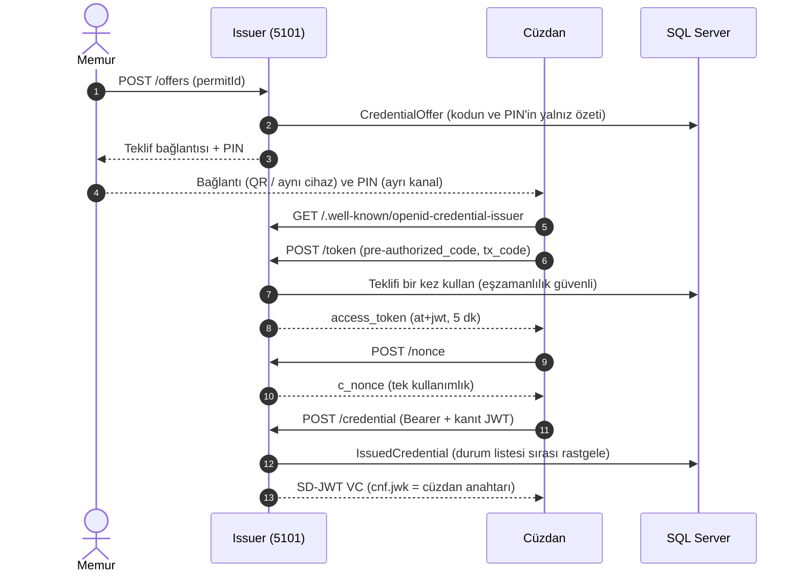

# Geliştirme Notu 5: Issuer: OpenID4VCI Uç Noktaları ve Memur Portalı

| | |
|---|---|
| Proje | `src/DijitalKimlik.Issuer` (`Oid4Vci/`, `Controllers/`, `Views/`) |
| Testler | `tests/DijitalKimlik.IntegrationTests/Oid4VciFlowTests.cs` (5 test, gerçek SQL Server) |
| Standartlar | OpenID4VCI 1.0, RFC 8414, RFC 6749/6750, SD-JWT VC, Token Status List |

## 1. Amaç

Bu fazdan sonra düzenleyici gerçekten kimlik bilgisi verir. Akış şöyle işler:

1. Memur, gişede kimliğini doğruladığı kişi için portalda **Teklif oluştur** düğmesine basar.
2. Ekranda bir teklif bağlantısı ve 6 haneli bir PIN çıkar. PIN kişiye sözlü ya da SMS ile söylenir.
3. Kişinin cüzdanı bağlantıyı açar, PIN'i ister ve OpenID4VCI uç noktalarını sırayla çağırır.
4. Cüzdan, kendi anahtarına bağlı bir SD-JWT VC alır.
5. Memur kimlik bilgisini askıya alabilir ya da iptal edebilir. Doğrulayıcı bunu durum listesinden görür.



## 2. Uç noktalar

| Uç nokta | Kim çağırır? | Ne döner? |
|---|---|---|
| `GET /.well-known/openid-credential-issuer` | Cüzdan | Düzenleyici metadata'sı: uç noktalar, kimlik bilgisi türü, Türkçe alan adları |
| `GET /.well-known/oauth-authorization-server` | Cüzdan | Token adresi. `authorization_servers` verilmediği için düzenleyici kendi yetkilendirme sunucusudur |
| `GET /.well-known/jwt-vc-issuer` | Doğrulayıcı | İmza doğrulama anahtarı (JWKS) |
| `POST /token` | Cüzdan | Form gövdesi: `grant_type`, `pre-authorized_code`, `tx_code`. Yanıt: `access_token` |
| `POST /nonce` | Cüzdan | `{"c_nonce": "..."}`, `Cache-Control: no-store` |
| `POST /credential` | Cüzdan | `Authorization: Bearer`, gövde `credential_configuration_id` + `proofs.jwt`. Yanıt: `{"credentials": [{"credential": "..."}]}` |
| `GET /status-lists/{id}` | Doğrulayıcı | `application/statuslist+jwt`: imzalı, sıkıştırılmış 2 bitlik liste |

Hatalar `{"error": ..., "error_description": ...}` biçiminde 400 ile döner. Token hataları RFC 6749'daki
`invalid_request`, `invalid_grant` ve `unsupported_grant_type`'tır. Credential hataları OpenID4VCI'deki
`invalid_proof`, `invalid_nonce`, `unknown_credential_configuration` ve `credential_request_denied`'dır.
Token yoksa 401 ve `WWW-Authenticate: Bearer error="invalid_token"` döner (RFC 6750).

Örnek: metadata'nın başı, geliştirme ortamında `curl -s http://localhost:5101/.well-known/openid-credential-issuer` ile:

```json
{"credential_issuer":"http://localhost:5101","credential_endpoint":"http://localhost:5101/credential",
 "nonce_endpoint":"http://localhost:5101/nonce","display":[{"name":"Demo Göç Kurumu","locale":"tr-TR"}],
 "credential_configurations_supported":{"DemoResidencePermit":{"format":"dc+sd-jwt",
 "vct":"urn:demo-goc-kurumu:ikamet-izni:1", ...
```

## 3. Kimlik bilgisinin içeriği

| Alan | Görünürlük | Açıklama |
|---|---|---|
| `iss`, `iat`, `exp`, `vct` | Her zaman açık | Kim verdi, ne zaman, ne zamana kadar, hangi tür |
| `cnf.jwk` | Her zaman açık | Cüzdanın açık anahtarı. Sunumdaki KB-JWT bu anahtarla doğrulanır |
| `status.status_list` | Her zaman açık | `idx` (listedeki sıra) ve `uri` (liste adresi) |
| `given_name`, `family_name`, `birthdate`, `nationality` | Seçerek açılır | Kişi bilgileri |
| `identity_number`, `permit_number`, `permit_type` | Seçerek açılır | İzin bilgileri. `permit_type` sabit bir koddur (`short_term`, `family`...) |
| `valid_from`, `valid_until` | Seçerek açılır | İznin geçerlilik dönemi |
| `age_over_18` | Seçerek açılır | Türetilmiş alan: "18 yaşından büyük mü?" doğum tarihi açılmadan cevaplanır |

İmzalı kısma 10 gerçek özetin yanında 3 sahte özet konur. Böylece doğrulayıcı kaç gizli alan olduğunu bilemez.

## 4. Tasarım kararları

| Karar | Neden? | Alternatif |
|---|---|---|
| Teklif değer olarak (`credential_offer=`) taşınır | Sunucuda ayrı bir teklif adresi ve durumu tutulmaz | `credential_offer_uri`: QR küçülür, ama teklif sunucudan bir kez daha indirilir |
| Kod 256 bit, PIN 6 hane; ikisinin yalnız özeti saklanır | Veritabanı sızsa da kod kullanılamaz. PIN, kodla birlikte özetlenir; tek başına kaba kuvvetle bulunamaz | PIN'siz teklif: bağlantıyı ele geçiren kimlik bilgisini alır |
| Teklifin kullanılması Faz 2'deki `IOfferRedeemer` ile | Aynı kodla eşzamanlı iki istekten yalnız biri geçer; beş hatalı PIN teklifi kilitler | — |
| Erişim token'ı imzalı JWT (`at+jwt`), 5 dakika | Sunucuda oturum tutulmaz; token kendi geçerliliğini taşır | Veritabanında opak token: anında geri alınabilir, her istekte sorgu ister |
| `c_nonce` bellekte, `TryRemove` ile tek kullanımlık | Yakalanan bir kanıt yeniden gönderilemez (replay). Tek sunucuda yeterli | Birden çok sunucuda Redis gibi paylaşılan depo |
| Nonce, kanıt doğrulamasının en son adımında tüketilir | İmzası bozuk bir istek geçerli bir nonce'u boşa harcatmaz | — |
| Kanıttaki `jwk` yeniden kurulur, öyle saklanır | Kimlik bilgisine yalnız açık anahtar alanları (`kty`, `crv`, `x`, `y`) yazılır | Gelen JWK'yı olduğu gibi koymak: fazladan alanlar taşınır |
| Durum listesi sırası rastgele, benzersiz indeks çakışmayı yakalar | Sıra numarasından kişinin kayıt sırası tahmin edilemez | Ardışık sıra: basit, ama kayıt zamanını sızdırır |
| Durum listesi her istekte veritabanından kurulur | Memur iptal edince doğrulayıcı bunu bir sonraki indirmede görür | Worker listeyi periyodik imzalar, önünde CDN durur: yük azalır, iptal `ttl` kadar gecikir |
| İmza anahtarı geliştirmede `App_Data/*.pem`, ilk açılışta üretilir | Kurulum gerektirmez. `App_Data/` git'e girmez | Üretimde HSM ya da Azure Key Vault / AWS KMS: özel anahtar uygulamaya hiç gelmez |
| Token isteğinin formu elle okunur | Bu bir HTML formu değil, cüzdanın POST'u; çerez ve oturum olmadığı için antiforgery anlamsız | `[FromForm]` + `DisableAntiforgery()` |
| Portal formlarında `[ValidateAntiForgeryToken]` | Memur sayfasındaki düğmeler çerezli tarayıcı istekleridir; CSRF'e açıktırlar | — |
| Panelde kimlik numarası maskeli (`990••••••01`) | Veri minimizasyonu: ekran görüntüsünde ya da omuz üstünden tam numara görünmez | Tam numara yalnız ayrıntı sayfasında, yetkiyle |
| Günlüğe kişi bilgisi yazılmaz | Kayıt: `CredentialId` ve durum listesi sırası; ad ya da kimlik numarası değil | — |

Memur girişi bu fazda yok: teklifi oluşturan kişi `demo-memur` olarak kaydedilir. Kimlik doğrulama
ve rol yetkisi yol haritasında ayrı bir adımdır.

## 5. Testler

Entegrasyon testi cüzdanı ve doğrulayıcıyı oynar. Issuer, Testcontainers'ın açtığı gerçek SQL Server
ile `WebApplicationFactory` içinde çalışır; istekler HTTP üzerinden gider.

| Test | Ne doğrular? |
|---|---|
| `Wallet_gets_a_credential_presents_two_claims_and_sees_the_revocation` | Metadata → token → nonce → credential. İmza JWKS'teki anahtarla doğrulanır, `cnf` cüzdan anahtarıdır, 10 alan açılabilir. Sunumda yalnız `age_over_18` ve `valid_until` gider, ad ve kimlik numarası gitmez. Durum listesi önce 0, iptalden sonra 1 der |
| `Wrong_pin_and_second_redemption_are_invalid_grant` | Yanlış PIN ve aynı teklifin ikinci kullanımı `invalid_grant` |
| `Nonce_is_single_use_and_proof_must_target_this_issuer` | Başka düzenleyiciye yazılmış kanıt `invalid_proof`, aynı nonce'un ikinci kullanımı `invalid_nonce` |
| `Credential_endpoint_without_access_token_is_401` | Geçersiz token 401 ve `WWW-Authenticate` |
| `Status_list_token_is_signed_and_self_describing` | Medya türü, `typ: statuslist+jwt`, `sub` = liste adresi, `bits: 2` |

Sonuç (Linux SDK konteyneri, Docker soketi bağlı):

```text
Passed!  - Failed: 0, Passed: 75, Skipped: 0, Total: 75 - DijitalKimlik.UnitTests.dll
Passed!  - Failed: 0, Passed: 39, Skipped: 0, Total: 39, Duration: 9 s - DijitalKimlik.IntegrationTests.dll
```

## 6. Elle deneme

Geliştirme veritabanı hazırsa (`scripts/dev-veritabani.ps1`):

```powershell
dotnet run --project src/DijitalKimlik.Issuer
# http://localhost:5101: panelde 5 hayali kişi; "Teklif oluştur" PIN'i ve bağlantıyı gösterir
curl -s http://localhost:5101/.well-known/openid-credential-issuer
curl -s -X POST http://localhost:5101/nonce
```

## 7. Çıkan sorunlar ve dersler

- **Geliştirme veritabanı geride kalmıştı.** `issuer.__EFMigrationsHistory`'de yalnız ilk migration
  vardı; Faz 3'ün iki migration'ı uygulanmamıştı. CI'daki dağıtım provasının yolu izlendi:
  `dotnet ef migrations script --idempotent` ile betik üretildi, `sqlcmd -b -I` ile uygulandı.
  Betik idempotent olduğu için var olan migration'lar atlandı. Ders: uygulama migration'ı kendisi
  uygulamıyorsa (DDL yetkisi yok), açılışta "veritabanı hangi sürümde?" kontrolü ya da sağlık
  kontrolü bu farkı erkenden gösterir.
- **JSON'da `+` işareti `+` diye çıkıyordu.** `JavaScriptEncoder.Create(UnicodeRanges.All)`
  Türkçe harfleri korur, ama HTML'e duyarlı karakterleri (`+`, `<`, `>`, `&`) yine kaçırır. Metadata'da
  `"format":"dc+sd-jwt"` görünüyordu. Geçerli JSON'dur, ama okunmaz. Kodlayıcı
  `UnsafeRelaxedJsonEscaping` oldu. Çıktı HTML'e gömülmez; ekranda gösterilirse Razor HTML kodlaması
  yapar. Birim testi eklendi.
- **Test anahtarı kaynak klasörüne yazılmasın.** `WebApplicationFactory` içerik kökünü proje klasörü
  yapar; anahtar `src/.../App_Data`'ya düşerdi. Test fabrikası anahtar yolunu geçici klasöre verir
  ve fabrika kapanınca dosyayı siler.

## 8. Terimler

| Terim | Anlamı |
|---|---|
| Pre-authorized code | Kullanıcının kimliği önceden (gişede) doğrulandığı için yetkilendirme ekranı olmadan verilen tek kullanımlık kod |
| `tx_code` | Teklifle birlikte ayrı kanaldan verilen PIN. Bağlantıyı ele geçiren biri PIN'siz kimlik bilgisini alamaz |
| Credential offer | Cüzdana "bu düzenleyiciden şu kimlik bilgisini al" diyen JSON; bağlantı ya da QR kodla taşınır |
| `c_nonce` | Düzenleyicinin verdiği tek kullanımlık rastgele değer. Kanıt JWT'si bunu imzalar; eski kanıt yeniden kullanılamaz |
| Kanıt JWT (proof) | Cüzdanın, başlığındaki açık anahtarın özel anahtarına sahip olduğunu gösteren imzalı JWT |
| `cnf.jwk` | Kimlik bilgisinin bağlı olduğu cüzdan anahtarı. Sunumda KB-JWT bu anahtarla imzalanır |
| JWKS | JSON Web Key Set: düzenleyicinin açık anahtar listesi. `kid` ile doğru anahtar seçilir |
| `at+jwt` | JWT biçimli OAuth erişim token'ının tür değeri (RFC 9068) |
| Durum listesi (status list) | Her kimlik bilgisi için 2 bit tutan, sıkıştırılmış ve imzalı liste. 0 geçerli, 1 geçersiz, 2 askıda |
| Antiforgery | Çerezli tarayıcı isteklerinde başka bir sitenin kullanıcı adına form göndermesini (CSRF) engelleyen gizli alan |
| Idempotent betik | Kaç kez çalıştırılırsa çalıştırılsın aynı sonucu veren betik; uygulanmış migration'ları atlar |
