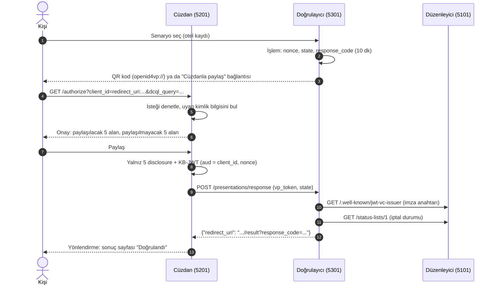

# Geliştirme Notu 7: Web Cüzdanı ve OpenID4VP Doğrulayıcı

| | |
|---|---|
| Projeler | `src/DijitalKimlik.Wallet` (`Credentials/`, `Presentations/`), `src/DijitalKimlik.Verifier` (`Presentations/`) |
| Testler | `tests/DijitalKimlik.IntegrationTests/EndToEndFlowTests.cs` (5 test: üç uygulama ve gerçek SQL Server) |
| Standartlar | OpenID4VCI 1.0 (cüzdan tarafı), OpenID4VP 1.0, DCQL, RFC 9901 SD-JWT, SD-JWT VC, Token Status List |
| Ekran görüntüleri | [Proje turu, 2. kısım](../proje-turu.md#2-çalışan-uygulama) |

Bu not Faz 7 (web cüzdanı) ile Faz 8'i (OpenID4VP doğrulayıcı) birlikte anlatır. İkisi aynı PR'da
geldi, çünkü biri olmadan öteki uçtan uca denenemez. Faz 6'nın memur portalı
[Not 5](05-issuer-oid4vci.md)'te.

## 1. Amaç

Bu fazdan sonra akışın üç ayağı da çalışır:

1. **Düzenleyici** (Issuer, 5101): memur teklif oluşturur; ekranda QR kod ve PIN çıkar.
2. **Cüzdan** (Wallet, 5201): kişi teklifi açar, PIN'i girer; cüzdan kimlik bilgisini kendi
   anahtarına bağlı olarak alır ve saklar.
3. **Doğrulayıcı** (Verifier, 5301): bir otel ya da bir mağaza yalnız işinin gerektirdiği
   alanları ister. Kişi cüzdanda neyin paylaşılacağını görür ve onaylar. Doğrulayıcı imzayı,
   cüzdan bağlamasını, süreyi, türü ve iptal listesini denetler.

Örnek: otel kaydı ad, soyad, uyruk, kimlik numarası ve iznin bitiş tarihini ister. Doğum tarihi,
izin numarası ve izin türü cüzdanda kalır. Yaş kontrolü yalnız `age_over_18 = true` bilgisini
alır; ad bile gitmez.



Doğrulayıcının istek sayfası, yanıt gelene kadar iki saniyede bir `GET /presentations/{id}/status`
sorar. Kişi QR kodu telefonla okuduysa sonuç bu yolla bilgisayar ekranına düşer.

## 2. Uç noktalar

**Cüzdan**

| Uç nokta | Ne yapar? |
|---|---|
| `GET /` | Kimlik bilgisi kartları: düzenleyici adı, tür, alanlar, bitiş tarihi |
| `GET /offers/receive?credential_offer=...` | Teklifi okur, düzenleyici metadata'sını indirir, PIN ister |
| `POST /offers/accept` | Token → nonce → yeni P-256 anahtar → kanıt JWT → credential. Gelen SD-JWT VC doğrulanır, sonra saklanır |
| `POST /credentials/{id}/delete` | Kimlik bilgisini cüzdandan siler |
| `GET /authorize?...` | OpenID4VP isteğini çözer, onay ekranını gösterir |
| `POST /authorize/respond` | `share`: sunumu yapar; `decline`: `error=access_denied` gönderir |

**Doğrulayıcı**

| Uç nokta | Ne yapar? |
|---|---|
| `GET /` | Senaryolar ve istedikleri alanlar |
| `POST /presentations` | Yeni işlem açar; tarayıcıya `dk-verifier` oturum çerezi verilir |
| `GET /presentations/{id}` | QR kod, cüzdan bağlantısı, teknik ayrıntılar |
| `GET /presentations/{id}/status` | `{"done": ..., "resultUrl": ...}`: polling için |
| `POST /presentations/response` | Cüzdanın `direct_post` yanıtı. Doğrular, `redirect_uri` döner |
| `GET /presentations/{id}/result` | Sonuç: adımlar, paylaşılan alanlar, açılmamış özet sayısı |

Sonuç sayfasını yalnız işlemi başlatan tarayıcı (oturum çerezi) ya da cüzdanın yönlendirdiği
tarayıcı (`response_code`) açabilir. İkisinin karşılaştırması sabit zamanlıdır
(`CryptographicOperations.FixedTimeEquals`).

Örnek istek (DCQL sorgusu okunsun diye URL kodlaması açıldı):

```text
http://localhost:5201/authorize?client_id=redirect_uri:http://localhost:5301/presentations/response
  &response_type=vp_token&response_mode=direct_post
  &response_uri=http://localhost:5301/presentations/response
  &nonce=...&state=...
  &dcql_query={"credentials":[{"id":"ikamet_izni","format":"dc+sd-jwt",
    "meta":{"vct_values":["urn:demo-goc-kurumu:ikamet-izni:1"]},
    "claims":[{"path":["given_name"]},{"path":["family_name"]},{"path":["nationality"]},
              {"path":["identity_number"]},{"path":["valid_until"]}]}]}
```

## 3. Doğrulayıcının denetimleri

Denetimler sırayla yapılır. Biri başarısız olursa sonrakiler çalışmaz ve hiçbir alan gösterilmez.

| Sıra | Denetim | Neye bakar? |
|---|---|---|
| 1 | Yanıt biçimi | `vp_token` bir JSON nesnesi; içinde sorgu kimliğiyle tek bir SD-JWT var; sonunda KB-JWT var |
| 2 | Güvenilir düzenleyici | `iss`, yapılandırmadaki `TrustedIssuers` listesinde |
| 3 | İmza ve özetler | Anahtar `iss`'in `/.well-known/jwt-vc-issuer` adresinden, `kid` ile. Her disclosure'ın özeti imzalı kısımda |
| 4 | Cüzdan bağlama (KB-JWT) | `aud` = tam `client_id`, `nonce` bu işlemin, `sd_hash` sunulan SD-JWT'nin; imza `cnf.jwk` ile; `iat` 5 dakikadan eski değil |
| 5 | Geçerlilik süresi | `exp` geçmemiş |
| 6 | Kimlik bilgisi türü | `vct` beklenen tür |
| 7 | İstenen alanlar | Senaryonun istediği her alan açılmış |
| 8 | İptal durumu | Durum listesi `iss` ile aynı adresten indirilir; `typ`, imza, `sub` ve `exp` denetlenir; sıradaki değer 0 olmalı |

Yanıt aynı işleme ikinci kez gelirse reddedilir: işlem `Interlocked` ile yalnız bir kez
tamamlanabilir.

## 4. Cüzdanın denetimleri

Cüzdan da kendini korur. Kötü niyetli bir doğrulayıcı ya da sahte bir düzenleyici kişiyi
kandırmaya çalışabilir.

| Durum | Cüzdanın tepkisi |
|---|---|
| Teklifteki düzenleyici `TrustedIssuers` listesinde değil | Teklif açılmaz |
| Metadata'daki `credential_issuer` teklifteki adresle aynı değil, ya da token/credential adresi başka bir sunucuda | Teklif açılmaz (metadata sahteciliği) |
| Gelen kimlik bilgisinin `iss`'i, `vct`'si ya da `cnf` parmak izi beklenenden farklı | Kimlik bilgisi saklanmaz |
| `client_id` `redirect_uri:` ile başlamıyor ya da `response_uri` o adresle aynı değil | İstek reddedilir: yanıt başka bir adrese gidemez |
| İmzalı istek (`request`, `request_uri`), birden çok kimlik bilgisi, `credential_sets`, iç içe alan yolu | "Desteklenmiyor" denir. Anlamadığı isteği yarım yanıtlamaz |
| Doğrulayıcının döndürdüğü `redirect_uri` başka bir sunucuda | Yönlendirme yapılmaz |
| Seçilen kimlik bilgisi bu cüzdanın deposunda değil | Sunum yapılmaz |

Yanlış PIN girilirse cüzdan "PIN yanlış ya da teklif geçersiz" der. Teklif beş hataya kadar
yeniden denenebilir (Faz 2'deki kilit kuralı).

## 5. Tasarım kararları

| Karar | Neden? | Alternatif |
|---|---|---|
| Cüzdan kimliği bir çerezde (`dk-wallet`, 16 bayt rastgele, HttpOnly, SameSite=Lax) | Hesap ve giriş olmadan çok kullanıcılı bir demo. Her tarayıcı kendi cüzdanını görür | ASP.NET Core Identity ile giriş; cüzdan hesaba bağlanır, cihaz değişince kaybolmaz |
| Her cüzdan bir dosya, Data Protection ile şifreli (`App_Data/wallets/`) | Özel anahtar ve kişi bilgisi diskte açık durmaz. Veritabanı gerekmez | Veritabanında şifreli sütun; telefonda Secure Enclave ya da Android Keystore |
| Her kimlik bilgisi için yeni P-256 anahtar | İki doğrulayıcı aynı anahtarı görüp kişiyi ilişkilendiremez | Tek cüzdan anahtarı: basit, ama izlenebilir |
| İstek imzasız, `client_id = redirect_uri:<response_uri>` | Yanıt yalnız istekte yazan adrese gider. Sertifika altyapısı gerektirmez | `x509_san_dns` ya da `verifier_attestation` ile imzalı `request_uri`: cüzdan doğrulayıcının kim olduğunu da bilir. Üretimde bu gerekir |
| `response_mode=direct_post` | Sunum tarayıcı adres çubuğundan ya da geçmişinden geçmez; doğrudan sunucuya gider | `fragment`: yanıt URL'de taşınır, günlüklere düşebilir |
| İşlemler bellekte, süresi dolan yeni işlem açılırken silinir | Tek sunucu için yeterli; kişisel veri kalıcı olarak saklanmaz | Birden çok sunucuda Redis (TTL'li anahtarlar) |
| Sonuç sayfası için polling (2 sn, jQuery `$.getJSON`) | Az kod, her proxy'den geçer | SignalR: anlık bildirim, ama bağlantı tutar ve ölçekte backplane ister |
| Cüzdanın ve doğrulayıcının HTTP istemcileri typed client (`IHttpClientFactory`), 10 sn zaman aşımı, 1 MB yanıt sınırı | Karşı taraf yavaşsa ya da dev bir yanıt dönerse uygulama kilitlenmez | Polly ile yeniden deneme ve devre kesici (yol haritasında) |
| Durum listesi `iss` ile aynı köke bağlı olmalı | Sahte bir kimlik bilgisi kendi "her şey geçerli" listesini gösteremez | Listeyi ayrı bir sunucuya koymak: ayrı güven kuralı ister |
| Doğrulayıcı sonucu yalnız bellekte tutar. Günlüğe işlem kimliği, senaryo ve sonuç yazılır; alan değeri yazılmaz | Veri minimizasyonu: otel kaydı için gereken bilgi, gerekenden uzun durmaz | — |
| Teklif QR kodu QRCoder 1.8.0 ile PNG data URI | Dış servis yok; sayfa kendi içinde. 1.8.1 yeni çıktığı için bir önceki kararlı sürüm seçildi | JavaScript QR kütüphanesi: sunucu yükü yok, ama ek bir istemci bağımlılığı |

Data Protection anahtarları geliştirmede varsayılan yerde, kullanıcı profilinde tutulur. Üretimde
anahtarlar paylaşılan ve korunan bir yere konmalıdır (`PersistKeysToFileSystem` ile bir birim ve
`ProtectKeysWith...`, ya da Azure Blob + Key Vault). Yoksa konteyner yeniden başlayınca cüzdan
dosyaları okunamaz.

## 6. Testler

Entegrasyon testi üç uygulamayı aynı süreçte açar: Issuer gerçek SQL Server'la, Wallet ve
Verifier `WebApplicationFactory` ile. Üç projenin de `Program` sınıfı olduğu için test projesi
Wallet'ı `wallet`, Verifier'ı `verifier` takma adıyla (`extern alias`) bağlar. Uygulamalar
birbirine gerçek HTTP yerine test sunucusunun işleyicisi üzerinden ulaşır.

| Test | Ne doğrular? |
|---|---|
| `Hotel_check_in_sees_only_the_requested_claims_and_then_the_revocation` | Teklif → PIN → cüzdan → otel sunumu. Doğrulayıcı tam 5 alanı görür; 8 özet (5 gizli alan + 3 sahte) açılmaz. Sonuç sayfasında "Doğrulandı". Memur iptal edince aynı kimlik bilgisi iptal adımında düşer |
| `Age_check_discloses_a_single_boolean` | Yaş kontrolünde yalnız `age_over_18` gider |
| `Presentation_for_another_nonce_fails_key_binding_and_a_second_answer_is_refused` | Başka işlemin nonce'uyla yapılmış sunum KB-JWT adımında düşer; aynı işleme ikinci yanıt reddedilir |
| `Wallet_refuses_a_request_that_answers_to_another_address` | `response_uri` `client_id`'deki adresten farklıysa cüzdan sunum yapmaz |
| `Wrong_pin_is_reported_and_the_offer_can_still_be_used` | Yanlış PIN anlaşılır bir hata verir; doğru PIN'le aynı teklif yine kullanılır |

Sonuç (Linux SDK konteyneri, Docker soketi bağlı, 24.10.2026):

```text
Passed!  - Failed: 0, Passed: 75, Skipped: 0, Total: 75, Duration: 67 ms - DijitalKimlik.UnitTests.dll
Passed!  - Failed: 0, Passed: 44, Skipped: 0, Total: 44, Duration: 4 s - DijitalKimlik.IntegrationTests.dll
```

Ayrıca akış gerçek bir tarayıcıda (Edge, headless, Chrome DevTools Protocol) baştan sona
yürütüldü ve her adımın ekran görüntüsü alındı. Sonuçlar: otel kaydı "Doğrulandı", yaş kontrolü
"Doğrulandı", iptalden sonra "Doğrulanamadı".

## 7. Elle deneme

Geliştirme veritabanı hazırsa (`scripts/dev-veritabani.ps1`), üç uygulama üç ayrı terminalde:

```powershell
dotnet run --project src/DijitalKimlik.Issuer     # http://localhost:5101
dotnet run --project src/DijitalKimlik.Wallet     # http://localhost:5201
dotnet run --project src/DijitalKimlik.Verifier   # http://localhost:5301
```

1. Issuer panelinde bir kişi için **Teklif oluştur**. PIN'i not et, **Cüzdanda aç**'a tıkla.
2. Cüzdanda PIN'i gir. Kimlik bilgisi kartı görünür.
3. Verifier'da **Otel konaklama kaydı**'nı başlat, **Cüzdanla paylaş**'a tıkla, cüzdanda onayla.
4. Issuer panelinde kimlik bilgisini iptal et, 3. adımı yinele: sonuç "Doğrulanamadı".

## 8. Çıkan sorunlar ve dersler

- **Razor Türkçe harfleri kodluyordu.** Sonuç sayfasında "Doğrulandı" HTML kaynağında
  `Do&#x11F;rulad&#x131;` diye çıkıyordu. Tarayıcı doğru gösterir, ama testteki metin araması
  başarısız oldu. `WebEncoderOptions` ile `UnicodeRanges.All` verildi; üç uygulamada da aynı ayar.
  HTML'e duyarlı karakterler (`<`, `>`, `&`, tırnak) yine kodlanır, XSS koruması sürer.
- **Aynı makinedeki üç uygulamanın çerezleri çakışabilirdi.** Çerezler porta göre ayrılmaz:
  `localhost:5101` ile `localhost:5201` aynı çerezleri görür. Varsayılan TempData çerezinin adı
  ikisinde de aynıydı (`.AspNetCore.Mvc.CookieTempDataProvider`) ve biri ötekinin mesajını
  silebilirdi. Adlar `dk-issuer-tempdata` ve `dk-wallet-tempdata` oldu. Ayar sınıfı
  `CookieTempDataProviderOptions`, `Microsoft.AspNetCore.Mvc` ad alanında; ilk denemede yanlış ad
  alanı yazıldı ve derleme hatası verdi.
- **Bootstrap'in `.mark` sınıfı.** Denetim satırlarındaki ✓ işaretine `mark` sınıfı verilmişti;
  Bootstrap bunu sarı vurgu olarak boyadı. Sınıf `check-mark` oldu. Ders: kendi sınıf adlarını
  çerçevenin adlarıyla çakışmayacak biçimde seç.
- **Bitiş tarihi bir gün kayıyordu.** `exp`, iznin son gününün gece yarısına (00:00) konmuştu.
  Cüzdan bu anı "21.10.2027" gösterdi, izin ise 20.10.2027'de bitiyor. `exp` artık son günün
  23:59:59'u (UTC). Ders: "bitiş günü" bir an değil bir aralıktır; zamana çevirirken hangi uca
  yuvarlandığı yazılmalıdır.
- **Ekran görüntüleri kişisel bilgi taşımamalı.** Görüntüler yalnız hayali kişileri ve
  `localhost` adreslerini içerir. Tarayıcı çerçevesi yok: görüntüler sayfanın kendisinden alındı.
  PNG'lerin meta verisi silindi (`-strip`); dosyalar kullanıcı adı, e-posta ve yerel klasör yolu
  için tarandı. Görüntüdeki PIN ve teklif kodu kullanılmış ve süresi dolmuş bir teklife ait.

## 9. Terimler

| Terim | Anlamı |
|---|---|
| Doğrulayıcı (verifier) | Kişiden kimlik bilgisi isteyen ve doğrulayan taraf: otel, banka, mağaza |
| Sunum (presentation) | Cüzdanın, kimlik bilgisinin seçilen alanlarını ve KB-JWT'yi doğrulayıcıya göndermesi |
| DCQL | Digital Credentials Query Language: doğrulayıcının hangi türden hangi alanları istediğini yazdığı JSON sorgu |
| `vp_token` | Cüzdanın yanıtı: sorgu kimliğine karşılık sunulan kimlik bilgileri |
| `direct_post` | Cüzdanın yanıtı tarayıcı yönlendirmesiyle değil, doğrudan doğrulayıcının adresine POST etmesi |
| `client_id` öneki (`redirect_uri:`) | Doğrulayıcının nasıl tanındığını söyler. `redirect_uri:` imzasız istektir; yanıt yalnız o adrese gider |
| KB-JWT (Key Binding JWT) | Cüzdanın `cnf.jwk` anahtarıyla imzaladığı kısa JWT. Sunumun bu isteğe ve bu cüzdana ait olduğunu gösterir |
| `sd_hash` | KB-JWT'deki, sunulan SD-JWT'nin (seçilen disclosure'larla birlikte) özeti. Disclosure eklenip çıkarılamaz |
| `nonce` / `state` | Doğrulayıcının her istek için ürettiği rastgele değerler. `nonce` eski sunumun yeniden kullanılmasını, `state` yanıtın başka işleme karışmasını önler |
| `response_code` | Cüzdanın yönlendirdiği tarayıcının sonucu görebilmesi için doğrulayıcının verdiği tek seferlik değer |
| Seçici açıklama (selective disclosure) | Kimlik bilgisinin yalnız istenen alanlarının açılması; ötekiler özet olarak kalır |
| Sahte özet (decoy digest) | Gerçek bir alana karşılık gelmeyen özet. Doğrulayıcı kaç gizli alan olduğunu bilemez |
| Data Protection | ASP.NET Core'un veri şifreleme API'si. Anahtarları kendisi üretir ve döndürür |
| `extern alias` | Aynı adlı tipleri (burada üç `Program`) içeren derlemeleri bir takma adla ayırma |
| Polling | Bir durumun değişip değişmediğini belli aralıklarla sorma |
