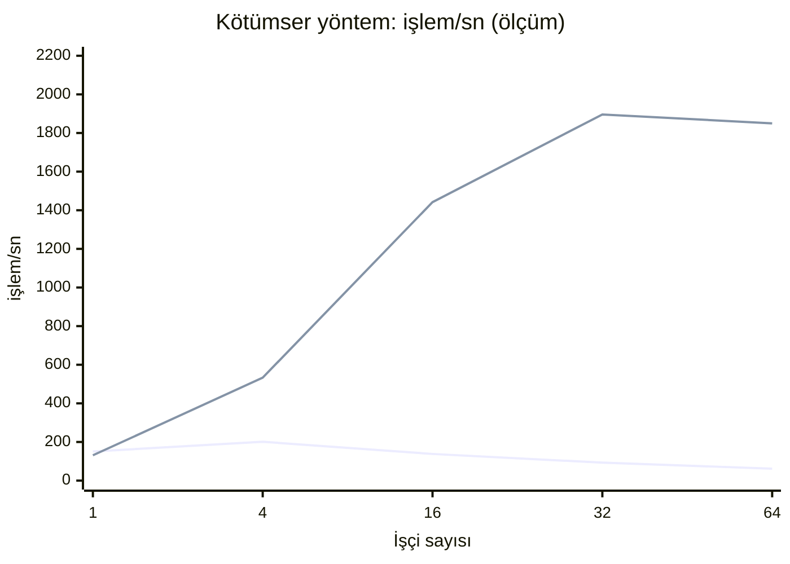

# Ölçüm 1: Teklif Kullanımında Dört Eşzamanlılık Yöntemi

| | |
|---|---|
| Araç | `tools/DijitalKimlik.Olcum` |
| Tarih | 21.10.2026 |
| Ham veri | `docs/olcumler/veri/oncesi/` ve `veri/sonrasi/` (CSV ve `ortam.txt`) |
| Ortam | Geliştirici dizüstü bilgisayarı (Core Ultra 9 285H, 32 GB). Docker Desktop/WSL2 (12 vCPU). Araç bir Linux konteynerinde (.NET 10, sunucu GC: çok çekirdekte çöp toplamayı paralel yapan, sunucu uygulamaları için olan mod), SQL Server 2022 ayrı bir konteynerde, ikisi aynı Docker ağında |

## Neden ölçtük

Testler yöntemlerin **doğru** çalıştığını kanıtlıyor: bir teklif yalnız bir kez kullanılıyor,
beşinci yanlış PIN teklifi kilitliyor. Testler yöntemlerin **ne kadar** iyi çalıştığını
söylemiyor. Ölçüm bu soruyu cevaplıyor ve testlerin göremediği bir hatayı yakaladı.

Dört yöntem Not 2 ve Not 3'te anlatılıyor: iyimser (`rowversion`), kötümser (`UPDLOCK`), atomik
(koşullu `UPDATE`) ve stored procedure (SP).

Okurken bilinmesi gereken terimler:

- **İşçi (worker):** aynı anda çalışan ve sürekli istek gönderen bir görev. 16 işçi, aynı anda 16
  isteğin işlendiği yük demektir.
- **İşlem/sn (throughput, verim):** saniyede başarıyla biten işlem sayısı. Yüksek olan iyidir.
- **Gecikme yüzdelikleri:** p50, isteklerin yarısının bu süreden kısa bittiğini söyler (medyan).
  p95, isteklerin %95'inin bu süreden kısa bittiğini söyler. Kalan %5 en yavaş isteklerdir. p99 da
  aynı mantıkla en yavaş %1'i ayırır. Ortalama yerine yüzdelik kullanılır, çünkü ortalama birkaç
  çok yavaş isteği gizler. Kullanıcının hissettiği yavaşlık p95 ve p99'dadır.

## Senaryolar

1. **Çekişme.** Aynı teklife aynı anda 10 istek geliyor. Doğru PIN ve yanlış PIN ayrı ayrı
   deneniyor, her yöntem için 30 tur. Her tur yeni bir teklifle yapılıyor.
2. **Verim.** Her işçi farklı bir teklifi kullanıyor; gerçek trafik de böyledir, her kullanıcının
   kendi teklifi vardır. İşçi sayısı 1, 4, 16, 32 ve 64. Her işçi 60 işlem yapıyor. Ölçülenler:
   saniyedeki işlem sayısı ve gecikme yüzdelikleri (p50/p95/p99).

Her istek yeni bir DI scope'u ile, yani yeni bir `DbContext` ile yapılır; tıpkı bir HTTP isteği
gibi. Ölçülmeden önce her yöntem 40 işlemle **ısıtılır**. Isıtma, ilk çağrılardaki tek seferlik
maliyetlerin (JIT derlemesi, bağlantı havuzunun dolması, SQL Server'ın sorgu planı üretmesi)
ölçüme karışmaması için yapılan, sonucu sayılmayan çalıştırmadır. Her işçi düzeyinde dört yöntem
sırayla koşar, böylece zamanla değişen koşullar (makinenin ısınması, arka plan işleri) tek bir
yöntemin aleyhine birikmez.

Çalıştırma (Docker açık olmalı):

```powershell
dotnet run --project tools/DijitalKimlik.Olcum -c Release -- --cikti artifacts/olcum
```

`DK_OLCUM_BAGLANTI` ortam değişkeni verilirse araç var olan bir SQL Server'ı kullanır. Veritabanı
adı `Olcum` ile bitmeli, çünkü araç her çalıştırmada o veritabanını silip yeniden kurar. Değişken
verilmezse Testcontainers geçici bir SQL Server açar.

## Bulgu: kötümser yöntemde örtük dönüşüm ve tablo taraması

İlk ölçümde kötümser yöntem (UPDLOCK) işçi sayısı arttıkça **yavaşladı**. Öteki üç yöntem ise
hızlandı. Belirtiler:

- 64 işçide saniyede 62 işlem yapabildi; SP aynı koşulda 3.030 işlem yaptı.
- p95 gecikme 1,2 saniyeye çıktı.

**Neden:** `FromSql($"... WHERE PreAuthorizedCodeHash = {hash}")` içinde `hash` düz bir C#
`string`'i. Bu parametre `nvarchar` (Unicode metin) olarak gider. Sütun ise `char(43)` (Unicode
olmayan, sabit uzunlukta metin) ve bir SQL **collation**'ı kullanıyor. Collation, metinlerin nasıl
karşılaştırılıp sıralanacağını belirleyen kurallar setidir (büyük/küçük harf, aksan, dil).

Zincirleme sonuç şöyle:

1. Tipler farklı olduğu için SQL Server karşılaştırmadan önce sütunu parametrenin tipine dönüştürür
   (`CONVERT_IMPLICIT`). Bu collation'da dönüşüm indeks sırasını korumaz.
2. Dönüştürülmüş değerde indeks aranamaz. SQL Server tabloyu baştan sona tarar.
3. Tarama `UPDLOCK` ile yapıldığı için okuduğu **her satırda** U kilidi (update kilidi: "bu satırı
   güncelleyeceğim, başkası güncellemesin") ister.
4. Başka bir isteğin kilitli tuttuğu ilgisiz bir teklife gelince bekler.

Sonuç: birbiriyle hiç ilgisi olmayan teklifler birbirini sıraya sokar. İşçi arttıkça bekleme
artar ve verim düşer.

Sorgu planıyla doğrulandı. **Clustered Index Scan** tablonun bütün satırlarını okumak, **Index
Seek** ise indeksten doğrudan aranan satıra gitmektir:

```text
nvarchar parametre:  Clustered Index Scan  WHERE: CONVERT_IMPLICIT(nchar(43), PreAuthorizedCodeHash) = @h
char(43) parametre:  Index Seek  IX_CredentialOffers_PreAuthorizedCodeHash
```

Öteki yöntemler bu hataya düşmüyor. LINQ ile yazılmış sorgularda EF parametre tipini sütunun
eşlemesinden alır (`char(43)`, unicode değil). SP çağrısında tip zaten açıkça veriliyor.

**Düzeltme:** `PessimisticOfferRedeemer` artık tipli parametre gönderiyor:
`new SqlParameter("@hash", SqlDbType.Char, 43)`.

**Regresyon testi:** `Pessimistic_lock_on_one_offer_does_not_block_another_offer`.

1. Birinci teklif açık bir transaction'da UPDLOCK ile tutulur.
2. Aynı anda ikinci teklif kötümser yöntemle kullanılır.
3. Test bunun 5 saniye içinde başarıyla bitmesini bekler.

Eski kodla test 5 saniye kilitte bekleyip başarısız oldu; yeni kodla geçiyor.

**Ders:**

- Parametre tipi sütunla aynı olmalı. `AddWithValue` ve düz string parametreler aynı tuzağa
  düşer.
- Doğruluk testi performans sorununu göstermez. Yük altında ölçmek gerekir.
- Ölçümün bulduğu hata bir teste dönüştürülür ki geri gelmesin.

### Verim (sonrası): işlem/sn

| Yöntem | 1 işçi | 4 işçi | 16 işçi | 32 işçi | 64 işçi |
|---|---:|---:|---:|---:|---:|
| İyimser | 144 | 673 | 1.790 | 2.265 | 2.670 |
| Kötümser | 131 | 533 | 1.442 | 1.896 | 1.850 |
| Atomik | 159 | 757 | 1.757 | 2.319 | 3.553 |
| SP | 211 | 832 | 1.926 | 2.284 | 4.007 |

### p95 gecikme (sonrası): ms

| Yöntem | 1 işçi | 4 işçi | 16 işçi | 32 işçi | 64 işçi |
|---|---:|---:|---:|---:|---:|
| İyimser | 7.9 | 6.7 | 16.7 | 21.1 | 40.1 |
| Kötümser | 8.9 | 9.3 | 20.1 | 27.7 | 64.0 |
| Atomik | 7.4 | 6.6 | 14.5 | 21.0 | 26.7 |
| SP | 5.6 | 8.2 | 12.6 | 22.3 | 23.3 |

### Kötümser: öncesi / sonrası

| İşçi | Öncesi işlem/sn | Sonrası işlem/sn | Öncesi p95 ms | Sonrası p95 ms |
|---:|---:|---:|---:|---:|
| 1 | 151 | 131 | 7.5 | 8.9 |
| 4 | 201 | 533 | 22.6 | 9.3 |
| 16 | 138 | 1442 | 124.1 | 20.1 |
| 32 | 93 | 1896 | 447.8 | 27.7 |
| 64 | 62 | 1850 | 1200.8 | 64.0 |



```mermaid
xychart-beta
    title "32 işçide işlem/sn (ölçüm, düzeltme sonrası)"
    x-axis [İyimser, Kötümser, Atomik, SP]
    y-axis "işlem/sn" 0 --> 2700
    bar [2265, 1896, 2319, 2284]
```

```mermaid
xychart-beta
    title "32 işçide p95 gecikme, ms (ölçüm, düzeltme sonrası)"
    x-axis [İyimser, Kötümser, Atomik, SP]
    y-axis "ms" 0 --> 38
    bar [21.1, 27.7, 21.0, 22.3]
```

### Çekişme (öncesi): aynı teklife 10 eşzamanlı istek, ilk tur hariç medyan ms

Tablo sütunları: "Doğru PIN: ms", 10 isteğin hepsinin bitme süresidir (ilk tur ısınma sayılıp
dışarıda bırakıldı, kalanların medyanı). "WrongTxCode / Locked", yanlış PIN senaryosunda 10 isteğin
kaçının "yanlış PIN, hakkın var" ve kaçının "kilitlendi" cevabı aldığıdır. "Son deneme sayısı",
turun sonunda teklifte kayıtlı yanlış deneme sayısıdır; 5 olmalıdır.

| Yöntem | Doğru PIN: ms | Başarılı | Yanlış PIN: ms | WrongTxCode / Locked | Son deneme sayısı |
|---|---:|---|---:|---|---|
| İyimser | 12.7 | 1 (30 turda) | 36.5 | 4/6 | 5 |
| Kötümser | 22.7 | 1 (30 turda) | 42.0 | 4/6 | 5 |
| Atomik | 14.6 | 1 (30 turda) | 24.3 | 4/6 | 5 |
| SP | 8.3 | 1 (30 turda) | 19.4 | 4/6 | 5 |

### Çekişme (sonrası): aynı teklife 10 eşzamanlı istek, ilk tur hariç medyan ms

| Yöntem | Doğru PIN: ms | Başarılı | Yanlış PIN: ms | WrongTxCode / Locked | Son deneme sayısı |
|---|---:|---|---:|---|---|
| İyimser | 7.8 | 1 (30 turda) | 26.7 | 4/6 | 5 |
| Kötümser | 12.2 | 1 (30 turda) | 27.9 | 4/6 | 5 |
| Atomik | 8.6 | 1 (30 turda) | 17.1 | 4/6 | 5 |
| SP | 5.2 | 1 (30 turda) | 13.3 | 4/6 | 5 |


"Kötümser yöntem" grafiğindeki ilk çizgi düzeltmeden önceki, ikincisi düzeltmeden sonraki ölçümdür.
Düzeltmeden önce işçi arttıkça verim düşüyor; sonra işçiyle birlikte artıyor.

## Sonuçların yorumu

- **Doğruluk:** 4 yöntem × 30 tur × 2 senaryoda sonuçlar hep aynı çıktı:
  - Doğru PIN'de her zaman tam 1 başarı.
  - Yanlış PIN'de her zaman 5 deneme ve kilit; sonuçların 4'ü WrongTxCode, 6'sı Locked.
- **Verim:** Kararı tek komutta veritabanına veren yöntemler (SP ve atomik) yüksek eşzamanlılıkta
  önde. Uygulama ile veritabanı arasında tek bir gidiş-dönüş (round trip) yeterli: önce oku, sonra
  karar ver, sonra yaz adımları yok. Kilit yalnız o tek komut süresince tutulur.
- **İyimser yöntem:** Farklı tekliflerde çakışma olmadığından yeniden deneme yok ve iyi ölçekleniyor.
  Aynı teklifte çekişme olunca yeniden denemeler gecikmeyi artırır; yanlış PIN senaryosu bunu
  gösteriyor.
- **Kötümser yöntem:** Düzeltmeden sonra bile en yavaşı. Okuma, kilit ve yazma için transaction
  boyunca birden çok tur gerekiyor. Buna karşın davranışı öngörülebilir ve çekişme altında kesin.
- **Ölçümün sınırları:**
  - Tek makinede yapıldı; araç ve veritabanı aynı donanımı paylaşıyor.
  - Her düzey tek bir çalıştırma. Öncesi ve sonrası çalıştırmaları arasında öteki yöntemler,
    kodları değişmediği halde, çoğunlukla %10–30 farklı çıktı. Bir noktada fark 4 katı buldu:
    iyimser yöntem, 32 işçi, 559 ile 2.265.
  - Bu yüzden yöntemleri sıralamak için değil, büyüklük mertebesini görmek için kullanılmalı.
    Örneğin kötümser yöntemde 64 işçide 62'den 1.850'ye çıkış, yaklaşık 30 kat.
- **5.000 kullanıcı için anlamı:** Kapasite planındaki tasarım hedefi saniyede 50 istek. En yavaş
  yöntem bile bu dizüstü bilgisayarda 1 işçiyle bunun iki katından fazlasını yapıyor (≈130/sn).
  Bu ölçekte darboğaz bu işlem değil; imza, ağ ve erişilebilirlik tasarımı daha belirleyici.
  Gerçek doğrulama Faz 16'da uçtan uca yük testiyle yapılacak.
