# Proje Turu: Aşama Aşama

| | |
|---|---|
| Durum tarihi | 24.10.2026 |
| Testler | 119 test (75 birim, 44 entegrasyon), hepsi geçiyor |
| Çalışan akış | Kimlik bilgisi verme (OpenID4VCI) → web cüzdanı → seçerek paylaşma ve doğrulama (OpenID4VP) → iptal |

Bu sayfa projenin bugün nerede olduğunu gösterir. Önce çalışan uygulama, sonra her aşamada ne
yapıldığı, nasıl doğrulandığı ve kanıtı gelir. Ayrıntılar her aşamanın geliştirme notundadır.

## 1. Kısaca durum

| Faz | Konu | Durum | Kanıt |
|---|---|---|---|
| 0 | Geliştirme ortamı, Git, GitHub güvenlik ayarları | Bitti | [Not 0](gelistirme/00-ortam-git-github.md) |
| 1 | Çözüm iskeleti, katmanlı mimari, domain modeli, CI | Bitti | [Not 1](gelistirme/01-iskelet-mimari-domain.md) |
| 2 | SQL Server, EF Core, üç eşzamanlılık yöntemi | Bitti | [Not 2](gelistirme/02-veritabani-ef-core-eszamanlilik.md) |
| 3 | Stored procedure, function, trigger, temporal table, veritabanı dağıtımı | Bitti | CI'da dağıtım provası, [Not 3](gelistirme/03-programlanabilirlik-sp-function-trigger.md) |
| 3b | Dört yöntemin yük altında ölçümü | Bitti | [Ölçüm 1](olcumler/01-eszamanlilik-yontemleri.md) |
| 4 | Kripto çekirdeği: JWS, SD-JWT VC, Token Status List | Bitti | 39 birim testi, [Not 4](gelistirme/04-kripto-sd-jwt.md) |
| 5–6 | OpenID4VCI uç noktaları ve memur portalı | Bitti | [Not 5](gelistirme/05-issuer-oid4vci.md) |
| 7–8 | Web cüzdanı ve OpenID4VP doğrulayıcı | Bitti | Uçtan uca testler, ekran görüntüleri, [Not 7](gelistirme/07-cuzdan-dogrulayici.md) |
| 9+ | ADO.NET, SOAP servisi, Windows servisi, güvenlik, Redis, izleme, gateway, yük testi, yayın | Planlı | — |

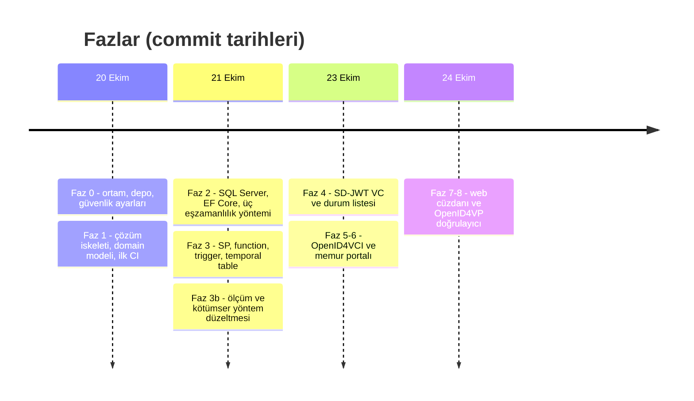

## 2. Çalışan uygulama

Üç ayrı web uygulaması birbirleriyle yalnız standart protokollerle konuşur:

| Uygulama | Adres | Kim kullanır? |
|---|---|---|
| Issuer (düzenleyici) | `localhost:5101` | Memur: teklif oluşturur, kimlik bilgisini askıya alır ya da iptal eder |
| Wallet (cüzdan) | `localhost:5201` | Kişi: kimlik bilgisini alır, saklar, neyi paylaşacağına karar verir |
| Verifier (doğrulayıcı) | `localhost:5301` | Otel, mağaza: yalnız gereken alanları ister ve doğrular |

Aşağıdaki animasyon akışın tamamını 12 karede gösterir. Görüntüler uygulamanın kendisinden,
headless Edge ile otomatik alındı. Kişiler hayalidir.

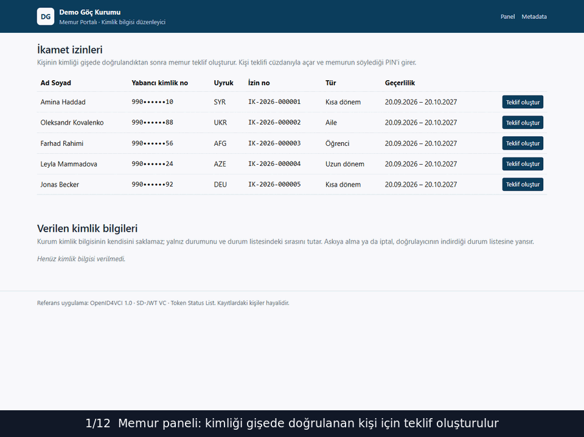

### Adım 1: Memur teklif oluşturur

Kişinin kimliği gişede doğrulanmıştır. Memur **Teklif oluştur**'a basar. Ekranda QR kod ve 6
haneli PIN çıkar. PIN kişiye sözlü ya da SMS ile söylenir: bağlantıyı ele geçiren biri PIN'siz
kimlik bilgisini alamaz. Panelde kimlik numarası maskelidir.

<table>
<tr>
<td width="50%">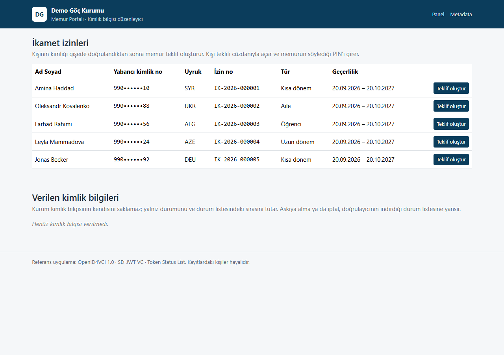</td>
<td width="50%">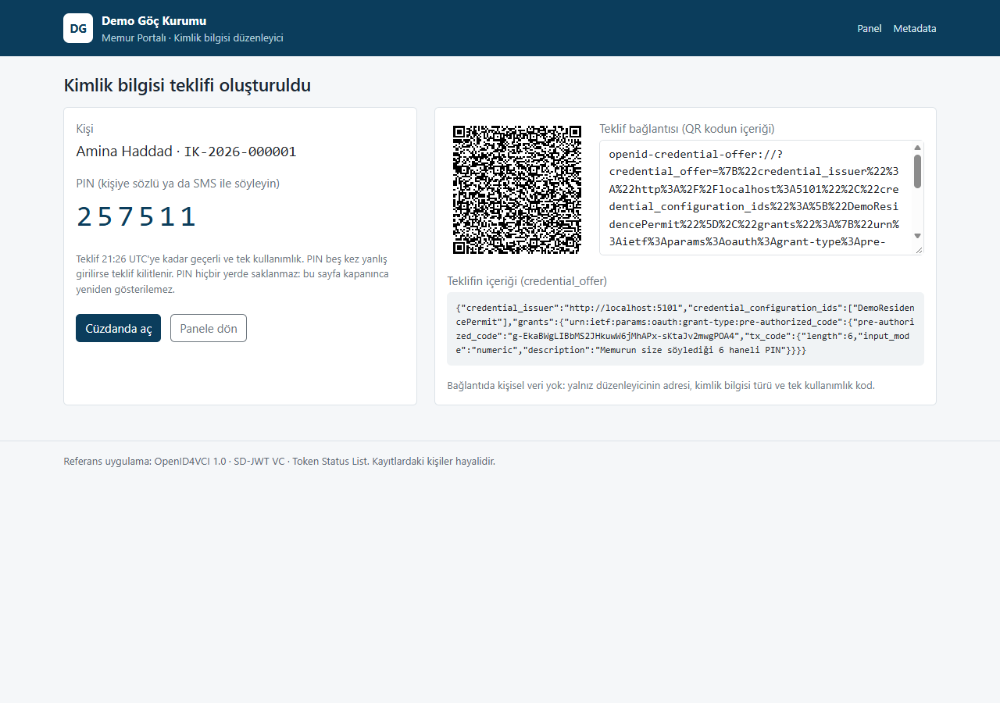</td>
</tr>
<tr>
<td>Memur paneli: ikamet izinleri ve verilen kimlik bilgileri</td>
<td>Teklif: QR kod, tek kullanımlık PIN ve teklifin içeriği</td>
</tr>
</table>

### Adım 2: Cüzdan kimlik bilgisini alır

Cüzdan teklifi açar, düzenleyicinin metadata'sını indirir ve PIN'i ister. Sonra OpenID4VCI uç
noktalarını sırayla çağırır: token, nonce, credential. Kimlik bilgisi bu cüzdanda üretilen yeni bir
anahtara bağlanır. Cüzdan imzayı, düzenleyiciyi ve anahtar bağlamasını doğrulamadan saklamaz.

<table>
<tr>
<td width="50%">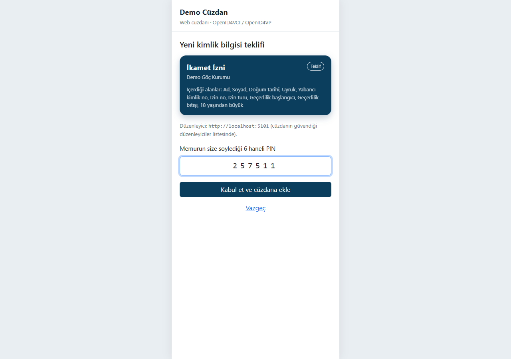</td>
<td width="50%">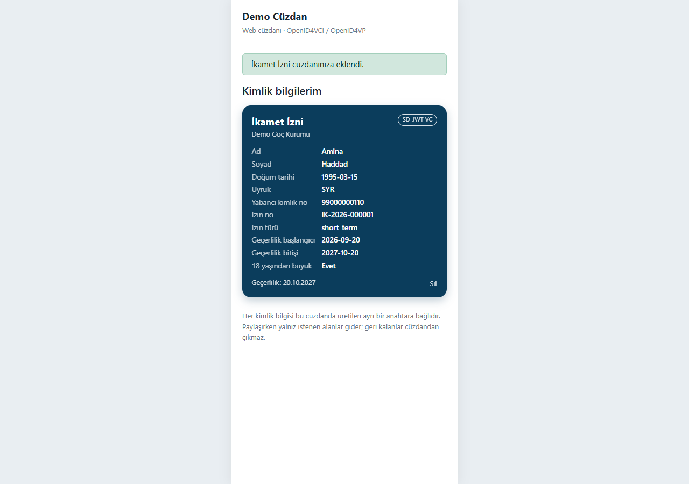</td>
</tr>
<tr>
<td>Cüzdan teklifi gösterir, kişi PIN'i girer</td>
<td>İkamet izni cüzdanda: 10 alan, hepsi seçerek açılabilir</td>
</tr>
</table>

### Adım 3: Otel kaydı, yalnız 5 alan

Otel resepsiyonu ad, soyad, uyruk, kimlik numarası ve iznin bitiş tarihini ister. Kişi cüzdanda
neyin gideceğini ve neyin kalacağını görür. Doğum tarihi, izin numarası, izin türü, başlangıç
tarihi ve yaş bilgisi cüzdandan çıkmaz.

<table>
<tr>
<td width="50%">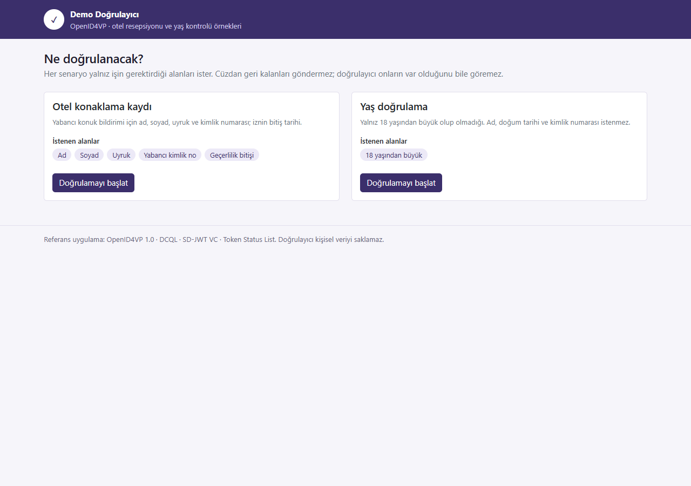</td>
<td width="50%">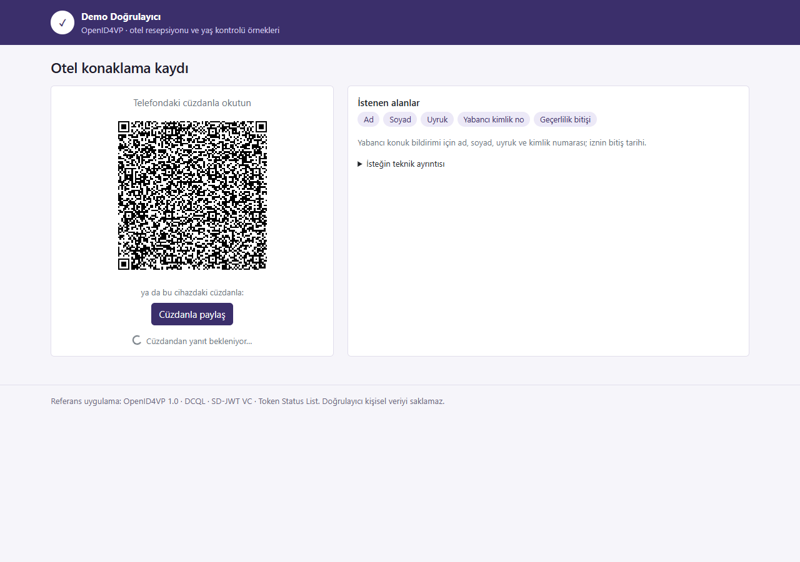</td>
</tr>
<tr>
<td>Doğrulayıcı: her senaryo yalnız işin gerektirdiği alanları ister</td>
<td>İstek: telefon için QR kod ya da aynı cihazdaki cüzdan için bağlantı</td>
</tr>
<tr>
<td width="50%">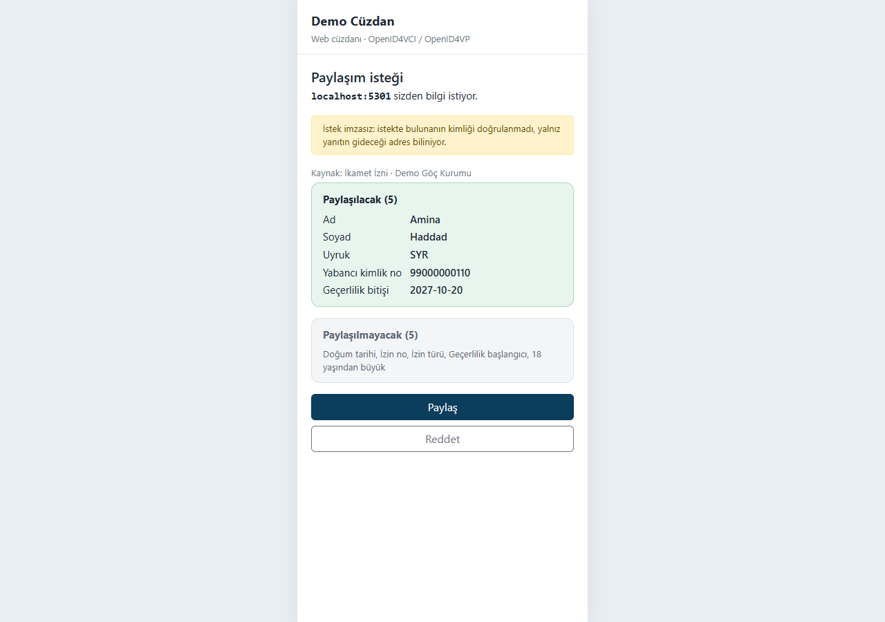</td>
<td width="50%">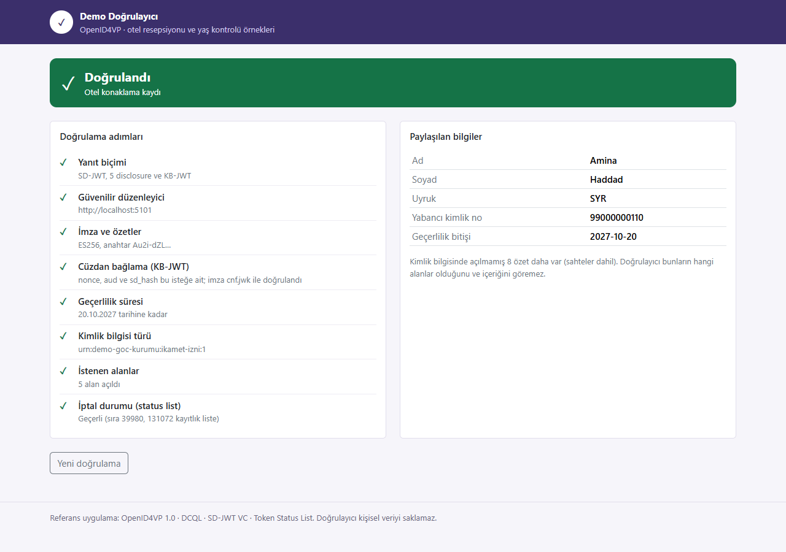</td>
</tr>
<tr>
<td>Onay ekranı: 5 alan paylaşılacak, 5 alan paylaşılmayacak</td>
<td>Sekiz denetimin hepsi geçti; doğrulayıcı yalnız 5 alanı görüyor</td>
</tr>
</table>

Doğrulayıcının sekiz denetimi: yanıt biçimi, güvenilir düzenleyici, imza ve özetler, cüzdan
bağlama (KB-JWT), geçerlilik süresi, kimlik bilgisi türü, istenen alanlar ve iptal durumu.
Sırası ve ayrıntısı [Not 7](gelistirme/07-cuzdan-dogrulayici.md)'nin 3. kısmında.

### Adım 4: Yaş kontrolü, tek bir evet/hayır

Bir mağaza yalnız "18 yaşından büyük mü?" sorusunu sorar. Ad, doğum tarihi ve kimlik numarası
gitmez. Bu alan (`age_over_18`) kimlik bilgisi verilirken düzenleyicinin hesapladığı türetilmiş
bir alandır.

<table>
<tr>
<td width="50%">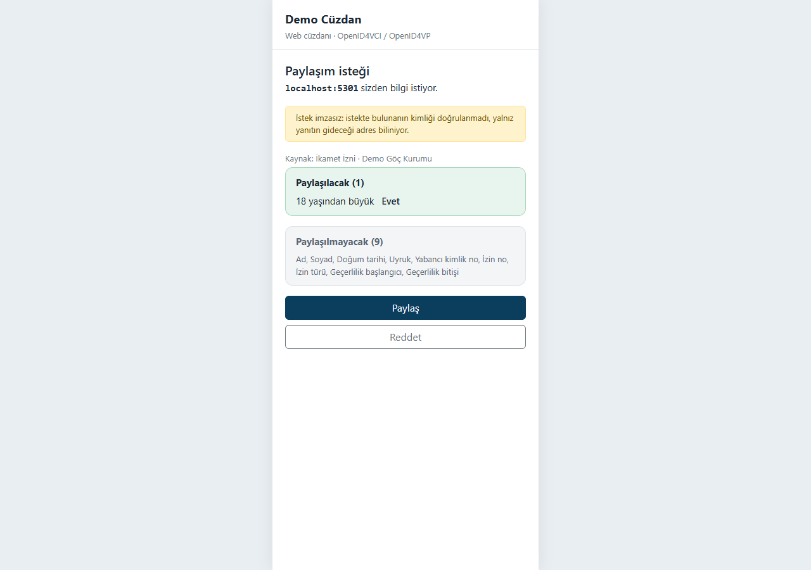</td>
<td width="50%">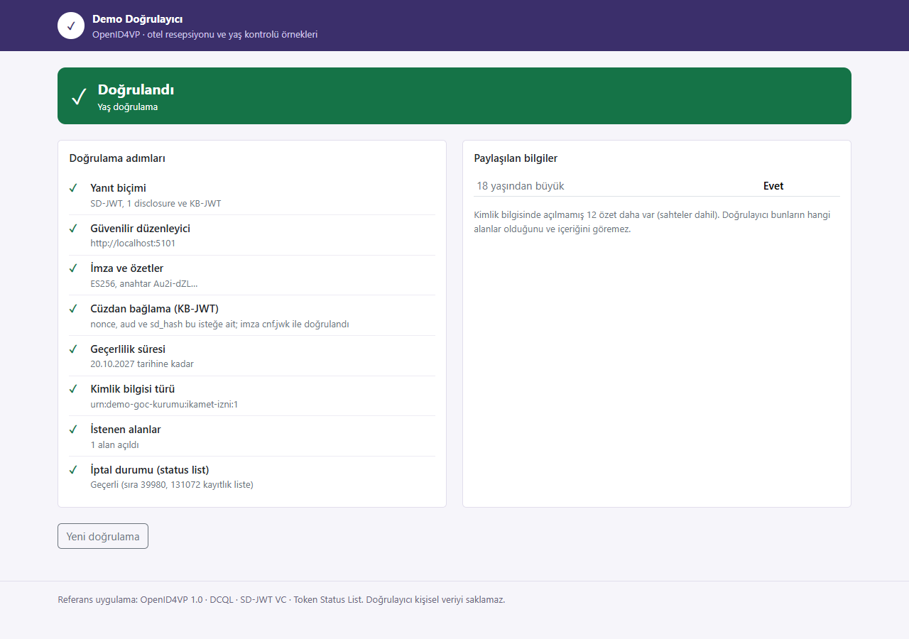</td>
</tr>
<tr>
<td>Yalnız "18 yaşından büyük" paylaşılacak</td>
<td>Doğrulandı: doğrulayıcı tek bir alan görüyor</td>
</tr>
</table>

### Adım 5: Memur iptal eder, doğrulama düşer

Memur kimlik bilgisini iptal eder. Düzenleyici bunu durum listesine (status list) yazar. Aynı
kimlik bilgisi aynı otele yeniden sunulunca imza, süre ve öteki denetimler yine geçer, ama iptal
denetimi düşer. Doğrulayıcı hiçbir alanı göstermez.

<table>
<tr>
<td width="50%">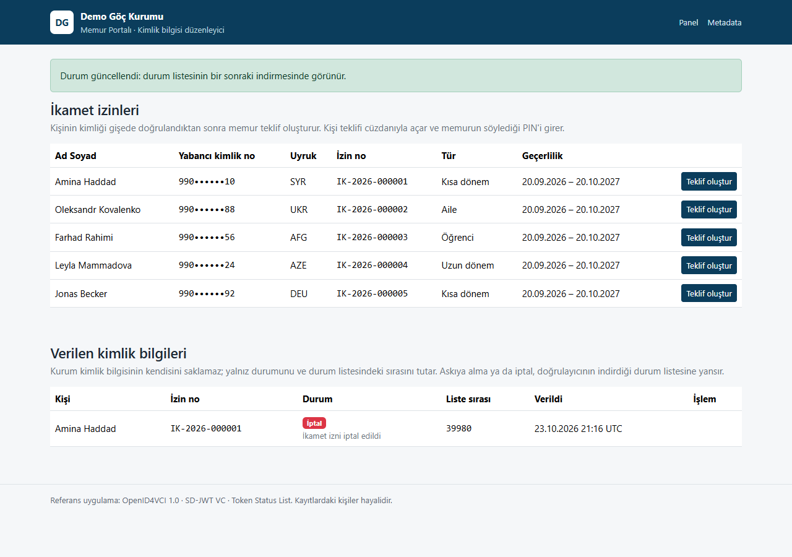</td>
<td width="50%">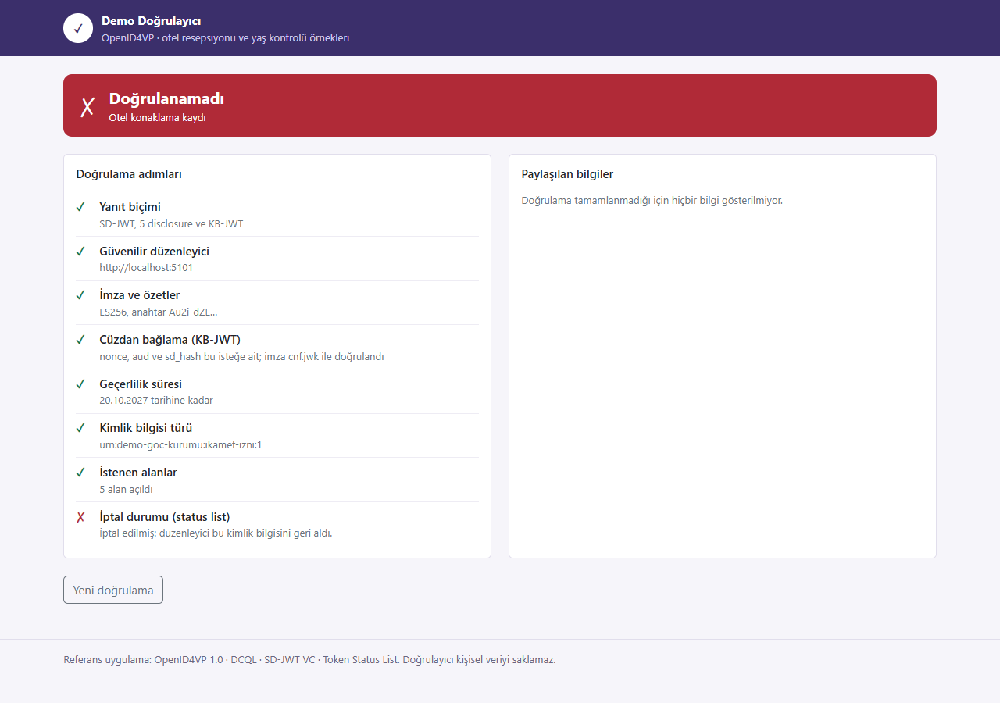</td>
</tr>
<tr>
<td>Kimlik bilgisi iptal edildi</td>
<td>Doğrulanamadı: durum listesinde "iptal"</td>
</tr>
</table>

Aynı akış CI'da da koşar: `EndToEndFlowTests` üç uygulamayı gerçek SQL Server'la açar ve bu beş
adımı HTTP üzerinden yürütür. Kendi makinende denemek için: [12. kısım](#12-kendin-dene).

## 3. Mimari

Her kutu bir projedir, her ok "şuna bağımlı" demektir. Yeşil kutularda çalışan ve test edilen kod
var. Gri kutular şimdilik şablon.

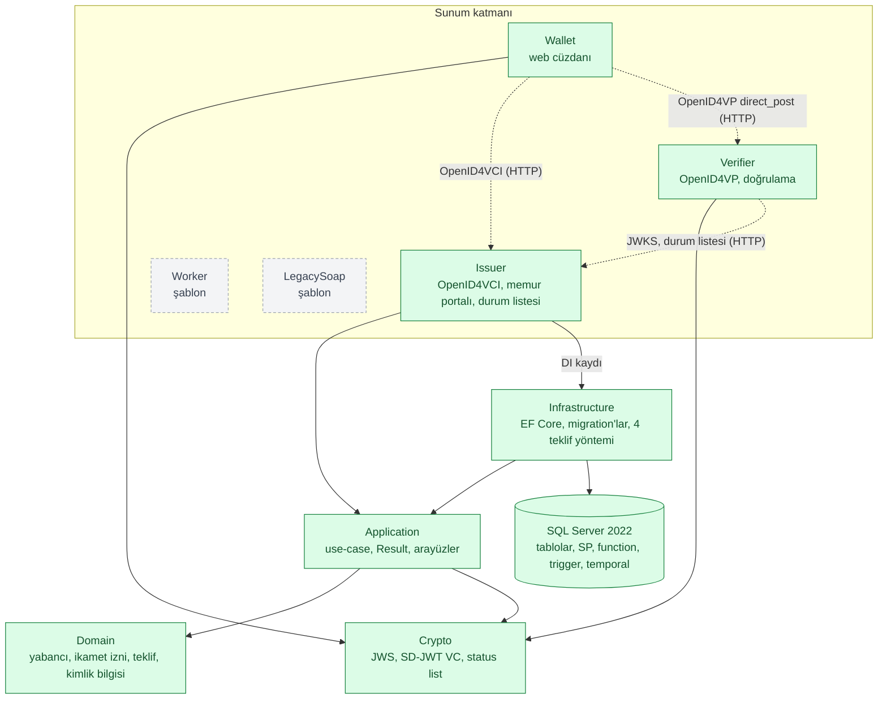

Kesikli oklar uygulamalar arasındaki HTTP çağrılarıdır. Wallet ve Verifier veritabanına
dokunmaz; yalnız Crypto'ya bağlıdır. Böylece cüzdan ve doğrulayıcı başka bir kurumun sunucusunda
da çalışabilir. Katmanların görevi [Not 1](gelistirme/01-iskelet-mimari-domain.md)'in 2. kısmında.

## 4. Faz 0: ortam ve depo

Amaç: herkesin aynı SDK sürümüyle derlediği, sırların ve kişisel bilgilerin depoya sızmadığı bir
başlangıç.

- .NET SDK 10.0.402 yönetici yetkisi olmadan kullanıcı klasörüne kuruldu. `global.json` sürümü
  sabitler; CI da aynı sürümü kurar.
- Commit'lerde GitHub'ın `noreply` e-posta adresi kullanılıyor. Kişisel adres geçmişe girmez.
- GitHub'da açık olan güvenlik ayarları:
  - **Dependabot uyarıları ve güvenlik güncellemeleri:** Kullanılan bir pakette açık çıkarsa
    uyarır ve düzelten PR'ı açar.
  - **Secret scanning ve push protection:** Parola ya da anahtar içeren bir push'u reddeder.
- Dependabot, NuGet paketlerinin ve GitHub Action'larının güncellemelerini de haftalık PR olarak
  öneriyor (`.github/dependabot.yml`).

Ayrıntı: [Not 0](gelistirme/00-ortam-git-github.md).

## 5. Faz 1: iskelet, domain modeli ve CI

Amaç: iş kurallarının veritabanından ve arayüzden bağımsız yazıldığı, her değişikliğin otomatik
denetlendiği bir iskelet.

- **Çözüm:** 9 uygulama projesi, 2 test projesi ve 1 ölçüm aracı (`DijitalKimlik.slnx`).
- **Domain modeli:**
  - `ForeignerIdentityNumber`: yabancı kimlik numarası, kontrol haneleriyle doğrulanan bir value
    object;
  - `Foreigner` ve `ResidencePermit`: yabancı ve ikamet izni;
  - `IssuedCredential`: verilen kimlik bilgisinin durum makinesi;
  - `CredentialOffer`: OpenID4VCI teklifi. Kod ve PIN yalnız özet (hash) olarak saklanır,
    PIN deneme sayısı sınırlıdır;
  - `StatusList`: iptal ve askıya alma listesi.
- **Application:** Hata durumunu istisna yerine sonuç nesnesiyle döndüren Result deseni ve
  `ForeignerService`.
- **CI** (`.github/workflows/ci.yml`):
  - Action'lar etikete değil commit SHA'sına sabit. Etiket başka bir commit'e taşınabilir, SHA
    taşınamaz.
  - İş akışının yetkisi yalnız okuma (`permissions: contents: read`).
  - Derleme Release modunda; uyarılar hata sayılır. `dotnet format --verify-no-changes` biçimi
    denetler. Testler kod kapsamıyla koşar.
- **Dal koruması:** `main`'e yalnız "Derleme ve test" işi geçmiş commit gelebilir. Zorla push ve
  dal silme kapalı. Kural yöneticilere de uygulanır.

Ayrıntı: [Not 1](gelistirme/01-iskelet-mimari-domain.md).

## 6. Faz 2: veritabanı ve eşzamanlılık

Amaç: verinin SQL Server'a EF Core ile yazılması ve gerçek bir yarış durumunun doğru çözülmesi.

**Sorun:** Bir kimlik bilgisi teklifi yalnız bir kez kullanılabilmeli. Aynı teklifle iki istek
aynı anda gelirse "oku, kontrol et, yaz" yapan naif kod ikisine de kimlik bilgisi verir. Üç
çözüm yazıldı; dördüncüsü Faz 3'te geldi:

| Yöntem | Nasıl çalışır |
|---|---|
| İyimser | Kilit yok. `rowversion` değişmişse güncelleme 0 satır etkiler; kod yeniden dener |
| Kötümser | Satır okunurken kilitlenir (`UPDLOCK, ROWLOCK`); ikinci istek bekler |
| Atomik | Okuma yok. Karar tek bir koşullu `UPDATE` ile verilir; 1 satır değiştiyse kazanan bu istektir |
| Stored procedure | Aynı koşullu güncelleme veritabanında, `issuer.usp_RedeemOffer` içinde (Faz 3) |

Kullanılacak yöntem yapılandırmadan seçilir (`Persistence:OfferRedemptionStrategy`). Dört yöntem
de aynı arayüzün keyed service olarak kayıtlı uygulamalarıdır.

Testler bellek içi bir taklitle değil, gerçek SQL Server'la koşar: Testcontainers her test
oturumunda bir SQL Server konteyneri açar. Eşzamanlılık testleri her yöntemi aynı teklife gelen
eşzamanlı isteklerle dener:

- doğru kod tam bir kez kullanılır;
- eşzamanlı yanlış PIN'ler teklifi tam beş hatadan sonra kilitler;
- süresi dolmuş teklif hiç kullanılamaz.

Bir test de sorunun gerçek olduğunu gösterir: naif kod aynı teklifi birçok kez kullandırıyor.

Ayrıntı: [Not 2](gelistirme/02-veritabani-ef-core-eszamanlilik.md).

## 7. Faz 3: veritabanı nesneleri ve dağıtım

Amaç: iş kuralının bir kısmını veritabanında çalıştırmak ve şemayı canlıya güvenle taşımak.

| Nesne | Adı | Gerçek işi |
|---|---|---|
| Scalar function | `issuer.ufn_IdentityNumberCheckDigits` | Yabancı kimlik numarasının kontrol haneleri, döngüyle |
| Inline TVF | `issuer.itvf_IdentityNumberCheckDigits` | Aynı hesap, tek `SELECT` ile |
| Stored procedure | `issuer.usp_RedeemOffer` | Teklif kullanımı: dördüncü eşzamanlılık yöntemi |
| Trigger | `issuer.trg_IssuedCredentials_StatusAudit` | Kimlik bilgisinin durumu değişince denetim kaydı |
| Temporal table | `issuer.ResidencePermits` + `ResidencePermitsHistory` | İkamet izninin her eski hâli |

**Dağıtım provası.** Canlıda migration'ı uygulama açılışta değil, kurulum adımı uygular. CI'daki
ikinci iş iki yolu da dener: DBA'ya verilecek idempotent SQL betiği ve tek dosyalık migration
bundle. İkisi de boş bir veritabanına **iki kez** uygulanır. İkinci çalıştırma hata vermemeli ve
hiçbir şeyi değiştirmemelidir. Bir çalışmanın günlüğünden:

```text
Çalıştırma 1
Applying migration '20261020205856_InitialIssuer'.
Applying migration '20261020215502_Programmability'.
Applying migration '20261020215720_ResidencePermitHistory'.
Done.
Çalıştırma 2
No migrations were applied. The database is already up to date.
Done.
DkBetik: migration,nesne,temporal = 3,4,1
DkBundle: migration,nesne,temporal = 3,4,1
```

Son iki satırda iki veritabanı aynı sonucu veriyor: 3 migration; 4 programlanabilir nesne (iki
function, bir stored procedure, bir trigger); 1 temporal tablo. Sonuç beklenenden farklı olsaydı
iş başarısız olurdu.

Ayrıntı: [Not 3](gelistirme/03-programlanabilirlik-sp-function-trigger.md).

## 8. Faz 3b: yük altında ölçüm

Amaç: dört yöntemin çekişme ve verim altında nasıl davrandığını sayıyla görmek.

**Bulgu.** Kötümser yöntem, işçi sayısı arttıkça yavaşlıyordu. Nedeni sorgu parametresinin
tipiydi: parametre `nvarchar` gidiyordu, sütun ise `char(43)`. SQL Server her satırı dönüştürmek
zorunda kaldı (`CONVERT_IMPLICIT`). İndeks kullanılamadı, tablo tarandı. Tarama, başka tekliflerin
`UPDLOCK` kilitlerinde bekledi.

**Düzeltme.** Parametre sütunla aynı tipte gönderildi: `SqlParameter(SqlDbType.Char, 43)`.

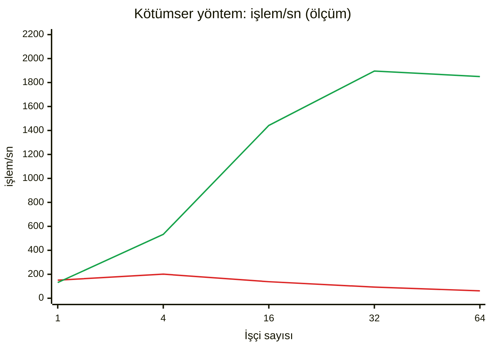

Kırmızı çizgi düzeltmeden önce, yeşil çizgi sonra. 64 işçide verim 62'den 1.850 işlem/sn'ye çıktı,
p95 gecikme 1.201 ms'den 64 ms'ye indi. `Pessimistic_lock_on_one_offer_does_not_block_another_offer`
testi eski kodla başarısız, yeni kodla başarılı; hata geri gelirse CI yakalar.

Ölçüm yöntemi, ortam, ham veri (CSV) ve öteki grafikler:
[Ölçüm 1](olcumler/01-eszamanlilik-yontemleri.md).

## 9. Faz 4–8: kimlik bilgisi verme, saklama ve doğrulama

| Faz | Ne yapıldı? | Öne çıkan karar |
|---|---|---|
| 4 | `DijitalKimlik.Crypto`: ES256 JWS, SD-JWT (RFC 9901) üretme, sunma ve doğrulama, KB-JWT, 2 bitlik sıkıştırılmış durum listesi | Dış paket yok; yalnız .NET'in kendi kripto ve sıkıştırma API'leri. Standardın test vektörleriyle denendi |
| 5–6 | Issuer: metadata, `/token` (pre-authorized code + PIN), `/nonce`, `/credential`, `/status-lists/{id}`; memur paneli, teklif, askıya alma ve iptal | Kod ve PIN yalnız özet olarak saklanır; teklif Faz 2'deki eşzamanlılık güvenli yöntemle bir kez kullanılır |
| 7 | Wallet: teklifi açma, PIN, kimlik bilgisini alma ve doğrulama, şifreli saklama, onay ekranı | Her kimlik bilgisi için yeni anahtar: iki doğrulayıcı kişiyi ilişkilendiremez |
| 8 | Verifier: DCQL ile istek, QR kod, `direct_post` yanıtı, sekiz denetim, sonuç sayfası | İstek imzasız (`redirect_uri:`), yanıt yalnız istekteki adrese gider; üretimde imzalı istek gerekir |

Ayrıntı: [Not 4](gelistirme/04-kripto-sd-jwt.md), [Not 5](gelistirme/05-issuer-oid4vci.md),
[Not 7](gelistirme/07-cuzdan-dogrulayici.md).

## 10. Testler

| Proje | Test | Kapsam | Süre |
|---|---:|---|---:|
| UnitTests | 75 | Domain, Application, Crypto (SD-JWT, JWS, durum listesi) | 67 ms |
| IntegrationTests | 44 | Gerçek SQL Server: eşzamanlılık, veritabanı nesneleri, Issuer, OpenID4VCI akışı, uçtan uca akış | 4 sn |
| **Toplam** | **119** | | |

Sayılar 24.10.2026'da Linux SDK konteynerinde alındı (Docker soketi bağlı, SQL Server
Testcontainers ile). Süreler derleme ve konteyner açılışı hariç test koşusudur. CI her PR'da aynı
testleri koşar; TRX ve kod kapsamı raporları çalışmanın `test-sonuclari` artifact'ındadır.

Faz 2'den bu yana her faz bir dalda geliştirildi, PR'da CI'dan geçti, sonra `main`'e alındı.
Bütün çalışmalar deponun Actions sekmesinde.

## 11. Sıradaki fazlar

| Faz | Konu |
|---|---|
| 9 | ADO.NET ile toplu işlemler |
| 10 ve sonrası | SOAP servisi (CoreWCF), Windows servisi (süre dolumu, durum listesi), güvenlik denetimleri ve memur girişi, Redis, loglama ve izleme, YARP gateway, k6 ile yük testi, CI/CD ile yayın |

Her faz aynı akışla ilerler: dal, kod ve test, PR, CI, `main`. Her fazın sonunda
`docs/gelistirme/` altına bir geliştirme notu eklenir.

## 12. Kendin dene

Gereken: .NET SDK 10.0.402 ve Docker. Entegrasyon testleri Docker'da SQL Server konteyneri açar.

```powershell
git clone https://github.com/sefatuncer/dijital-kimlik-oid4vc
cd dijital-kimlik-oid4vc
. .\scripts\ortam.ps1    # SDK kullanıcı klasörüne kuruluysa oturumda etkinleştirir
dotnet build
dotnet test               # beklenen: 119 testin hepsi geçer
```

Uygulamayı tarayıcıda görmek için önce geliştirme veritabanını kur
([Not 2](gelistirme/02-veritabani-ef-core-eszamanlilik.md), 2. kısım), sonra üç uygulamayı üç
ayrı terminalde başlat:

```powershell
dotnet run --project src/DijitalKimlik.Issuer     # http://localhost:5101
dotnet run --project src/DijitalKimlik.Wallet     # http://localhost:5201
dotnet run --project src/DijitalKimlik.Verifier   # http://localhost:5301
```

Akış: Issuer'da **Teklif oluştur** → **Cüzdanda aç** → PIN → Verifier'da bir senaryo →
**Cüzdanla paylaş** → **Paylaş**. Ayrıntılı adımlar [Not 7](gelistirme/07-cuzdan-dogrulayici.md)'nin
7. kısmında.

## 13. Bu sayfadaki sayılar ve görseller nereden geldi?

| İçerik | Kaynak |
|---|---|
| Ekran görüntüleri ve animasyon | Geliştirme ortamında üç uygulama; headless Edge'i Chrome DevTools Protocol ile süren bir betik. PNG'lerin meta verisi silindi |
| Test sayıları ve süreler | 24.10.2026, Linux SDK konteynerinde `dotnet test` çıktısı |
| Dağıtım provası çıktısı | CI'daki "Veritabanı dağıtım provası" işinin günlüğü |
| Ölçüm grafiği | `docs/olcumler/veri/` altındaki ham CSV dosyaları |

## 14. Terimler

| Terim | Ne demek? |
|---|---|
| CI (sürekli entegrasyon) | Her değişiklikte kodu otomatik derleyen ve test eden iş akışı |
| PR (pull request) | Bir daldaki değişikliğin ana dala alınmadan önce incelenmesi ve denetlenmesi |
| Dal koruması | Ana dala hangi koşulla commit gelebileceğini belirleyen GitHub kuralı |
| Value object | Kimliği değil değeri önemli olan, kendi kuralını kendisi denetleyen küçük nesne |
| Result deseni | Başarı ya da hatayı istisna fırlatmadan, dönen nesneyle bildirme |
| Keyed service | Aynı arayüzün birden çok uygulamasını bir anahtarla kaydedip anahtarla çağırma (.NET 8+) |
| Testcontainers | Testlerde gerçek bir veritabanını Docker konteyneri olarak açan kütüphane |
| Idempotent betik | Kaç kez çalıştırılırsa çalıştırılsın aynı sonucu veren betik |
| Migration bundle | EF Core migration'larını uygulayan tek dosyalık program |
| Temporal table | Her satırın eski hâllerini SQL Server'ın kendisinin sakladığı tablo |
| `CONVERT_IMPLICIT` | SQL Server'ın tipleri uyuşmayan değerleri kendiliğinden dönüştürmesi; indeksi kullanılamaz kılabilir |
| p95 gecikme | İsteklerin %95'inin bu süreden kısa sürdüğü değer |
| SD-JWT VC | Sahibinin alanları tek tek gösterebildiği, imzalı dijital kimlik bilgisi biçimi |
| OpenID4VCI / OpenID4VP | Kimlik bilgisini cüzdana verme / cüzdandan isteyip doğrulama protokolleri |
| KB-JWT | Cüzdanın kendi anahtarıyla imzaladığı kısa JWT: sunumun bu isteğe ve bu cüzdana ait olduğunu gösterir |
| Durum listesi (status list) | Düzenleyicinin, her kimlik bilgisi için geçerli/iptal/askıda bilgisini tuttuğu imzalı liste |
| DCQL | Doğrulayıcının hangi kimlik bilgisinden hangi alanları istediğini yazdığı JSON sorgu |
