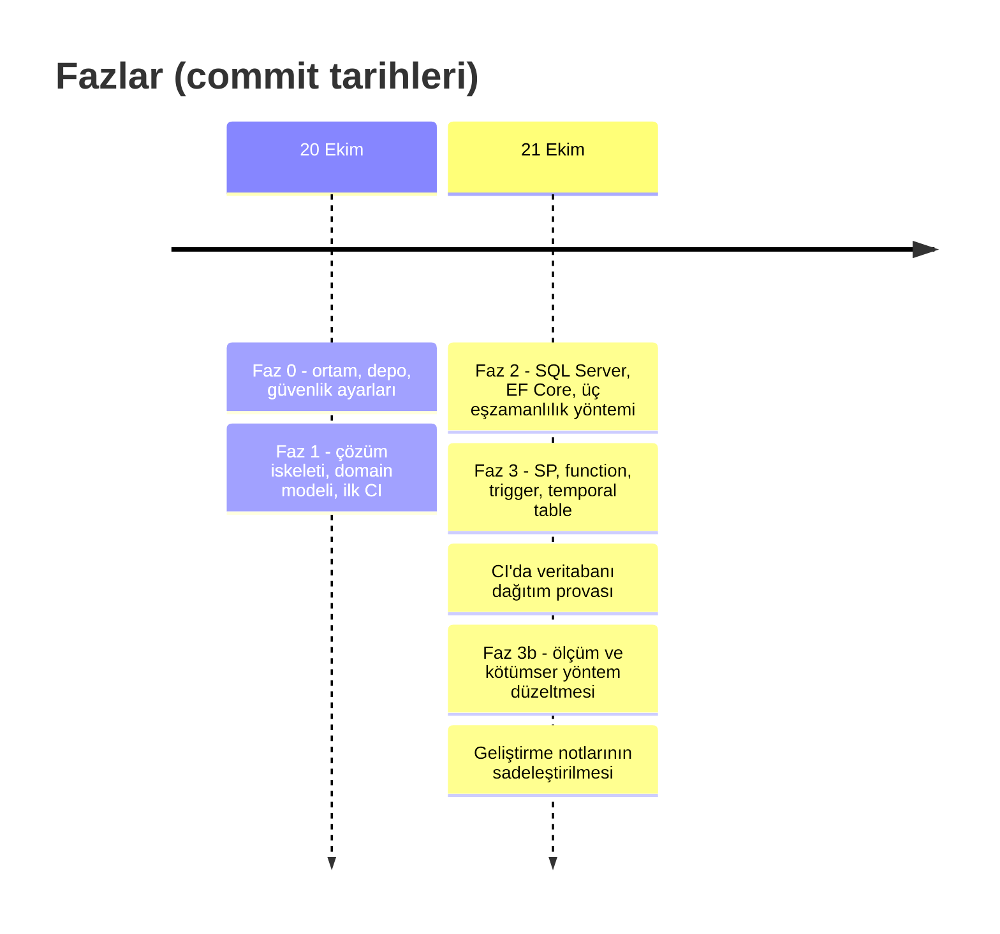
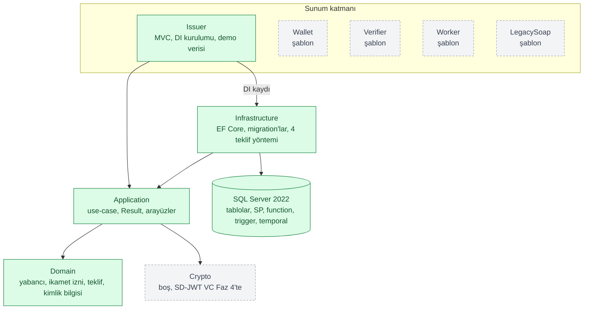
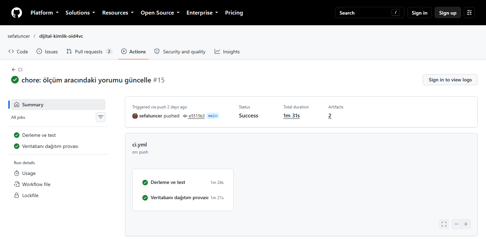
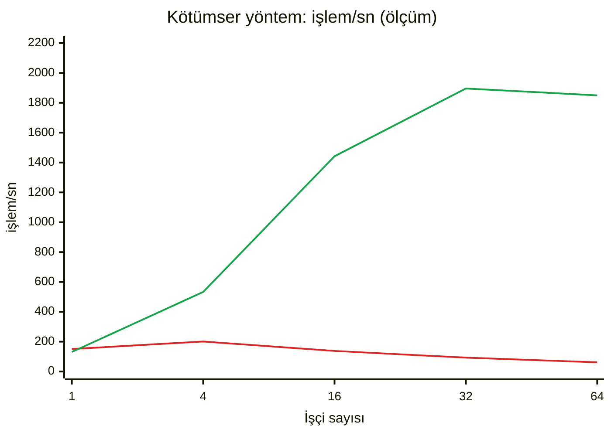
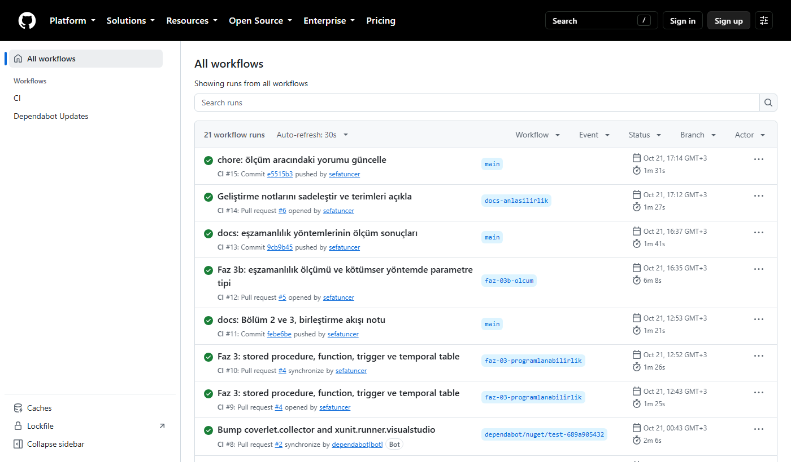

# Proje Turu: Aşama Aşama

| | |
|---|---|
| Durum tarihi | 23.10.2026 |
| Commit | `e5515b3` (`main`) |
| Testler | 69 test (35 birim, 34 entegrasyon), hepsi geçiyor |
| CI | 21 çalışma: 20 başarılı, 1 iptal (aynı dala yeni push gelince eskisi durduruldu) |

Bu sayfa projenin bugün nerede olduğunu aşama aşama gösterir. Her aşamada ne yapıldığı, nasıl
doğrulandığı ve kanıtı yer alır. Kanıt CI çıktısı, test sonucu ya da ölçümdür. Ayrıntılar her
aşamanın geliştirme notundadır.

> [!NOTE]
> Issuer, Wallet ve Verifier uygulamaları bugün ASP.NET Core MVC'nin şablon sayfasıyla açılıyor.
> Kimlik bilgisini veren (OpenID4VCI) ve doğrulayan (OpenID4VP) uç noktalar henüz yazılmadı. Bu
> yüzden bu sayfada arayüz görüntüsü yok. Akış çalışınca ekran görüntüleri ve uçtan uca akışı
> gösteren kısa bir animasyon (GIF) eklenecek.

## 1. Kısaca durum

| Faz | Konu | Durum | Kanıt |
|---|---|---|---|
| 0 | Geliştirme ortamı, Git, GitHub güvenlik ayarları | Bitti | [Not 0](gelistirme/00-ortam-git-github.md) |
| 1 | Çözüm iskeleti, katmanlı mimari, domain modeli, CI | Bitti | 35 birim testi, [Not 1](gelistirme/01-iskelet-mimari-domain.md) |
| 2 | SQL Server, EF Core, üç eşzamanlılık yöntemi | Bitti | Gerçek SQL Server'la entegrasyon testleri, [Not 2](gelistirme/02-veritabani-ef-core-eszamanlilik.md) |
| 3 | Stored procedure, function, trigger, temporal table, veritabanı dağıtımı | Bitti | CI'da dağıtım provası, [Not 3](gelistirme/03-programlanabilirlik-sp-function-trigger.md) |
| 3b | Dört yöntemin yük altında ölçümü | Bitti | [Ölçüm 1](olcumler/01-eszamanlilik-yontemleri.md) |
| 4–8 | Kripto çekirdeği (SD-JWT VC), OpenID4VCI, memur portalı, web cüzdanı, OpenID4VP | Sırada | — |
| 9+ | SOAP servisi, Windows servisi, güvenlik, Redis, izleme, gateway, yük testi, yayın | Planlı | — |

Aşağıdaki zaman çizelgesi commit tarihlerinden çıkarıldı:



## 2. Mimari: bugün ne var?

Her kutu bir projedir, her ok "şuna bağımlı" demektir. Yeşil kutularda çalışan ve test edilen kod
var. Gri kutular şimdilik şablon ya da boş proje.



Wallet, Verifier ve Worker da Issuer gibi Application ve Infrastructure'a bağlı. Şekil sade kalsın
diye bu oklar çizilmedi.
Katmanların görevi ve bağımlılık kuralı [Not 1](gelistirme/01-iskelet-mimari-domain.md)'in
2. kısmında.

## 3. Faz 0: ortam ve depo

Amaç: herkesin aynı SDK sürümüyle derlediği, sırların ve kişisel bilgilerin depoya sızmadığı bir
başlangıç.

- .NET SDK 10.0.402 yönetici yetkisi olmadan kullanıcı klasörüne kuruldu. `global.json` sürümü
  sabitler; CI da aynı sürümü kurar.
- Commit'lerde GitHub'ın `noreply` e-posta adresi kullanılıyor. Kişisel adres geçmişe girmez.
- GitHub'da açık olan güvenlik ayarları:
  - **Dependabot uyarıları ve güvenlik güncellemeleri:** Kullanılan bir pakette açık çıkarsa
    uyarır ve düzelten PR'ı açar.
  - **Secret scanning ve push protection:** Parola ya da anahtar içeren bir push'u reddeder.
- Dependabot, NuGet paketlerinin ve GitHub Action'larının güncellemelerini de haftalık PR olarak
  öneriyor (`.github/dependabot.yml`).

Ayrıntı: [Not 0](gelistirme/00-ortam-git-github.md).

## 4. Faz 1: iskelet, domain modeli ve CI

Amaç: iş kurallarının veritabanından ve arayüzden bağımsız yazıldığı, her değişikliğin otomatik
denetlendiği bir iskelet.

- **Çözüm:** 9 uygulama projesi, 2 test projesi ve 1 ölçüm aracı (`DijitalKimlik.slnx`).
- **Domain modeli:**
  - `ForeignerIdentityNumber`: yabancı kimlik numarası, kontrol haneleriyle doğrulanan bir value
    object;
  - `Foreigner` ve `ResidencePermit`: yabancı ve ikamet izni;
  - `IssuedCredential`: verilen kimlik bilgisinin durum makinesi;
  - `CredentialOffer`: OpenID4VCI teklifi. Kod ve PIN yalnız özet (hash) olarak saklanır,
    PIN deneme sayısı sınırlıdır;
  - `StatusList`: iptal ve askıya alma listesi.
- **Application:** Hata durumunu istisna yerine sonuç nesnesiyle döndüren Result deseni ve
  `ForeignerService`.
- **CI** (`.github/workflows/ci.yml`):
  - Action'lar etikete değil commit SHA'sına sabit. Etiket başka bir commit'e taşınabilir, SHA
    taşınamaz.
  - İş akışının yetkisi yalnız okuma (`permissions: contents: read`).
  - Derleme Release modunda; uyarılar hata sayılır. `dotnet format --verify-no-changes` biçimi
    denetler. Testler kod kapsamıyla koşar.
- **Dal koruması:** `main`'e yalnız "Derleme ve test" işi geçmiş commit gelebilir. Zorla push ve
  dal silme kapalı. Kural yöneticilere de uygulanır.

Son CI çalışmasının özeti (GitHub Actions, 21.10.2026). İki iş paralel koşuyor; toplam süre 1 dk
31 sn:



Ayrıntı: [Not 1](gelistirme/01-iskelet-mimari-domain.md).

## 5. Faz 2: veritabanı ve eşzamanlılık

Amaç: verinin SQL Server'a EF Core ile yazılması ve gerçek bir yarış durumunun doğru çözülmesi.

**Sorun:** Bir kimlik bilgisi teklifi yalnız bir kez kullanılabilmeli. Aynı teklifle iki istek
aynı anda gelirse "oku, kontrol et, yaz" yapan naif kod ikisine de kimlik bilgisi verir. Üç
çözüm yazıldı; dördüncüsü Faz 3'te geldi:

| Yöntem | Nasıl çalışır |
|---|---|
| İyimser | Kilit yok. `rowversion` değişmişse güncelleme 0 satır etkiler; kod yeniden dener |
| Kötümser | Satır okunurken kilitlenir (`UPDLOCK, ROWLOCK`); ikinci istek bekler |
| Atomik | Okuma yok. Karar tek bir koşullu `UPDATE` ile verilir; 1 satır değiştiyse kazanan bu istektir |
| Stored procedure | Aynı koşullu güncelleme veritabanında, `issuer.usp_RedeemOffer` içinde (Faz 3) |

Kullanılacak yöntem yapılandırmadan seçilir (`Persistence:OfferRedemptionStrategy`). Dört yöntem
de aynı arayüzün keyed service olarak kayıtlı uygulamalarıdır.

Testler bellek içi bir taklitle değil, gerçek SQL Server'la koşar: Testcontainers her test
oturumunda bir SQL Server konteyneri açar. Eşzamanlılık testleri her yöntemi aynı teklife gelen
eşzamanlı isteklerle dener:

- doğru kod tam bir kez kullanılır;
- eşzamanlı yanlış PIN'ler teklifi tam beş hatadan sonra kilitler;
- süresi dolmuş teklif hiç kullanılamaz.

Bir test de sorunun gerçek olduğunu gösterir: naif kod aynı teklifi birçok kez kullandırıyor.

Ayrıntı: [Not 2](gelistirme/02-veritabani-ef-core-eszamanlilik.md).

## 6. Faz 3: veritabanı nesneleri ve dağıtım

Amaç: iş kuralının bir kısmını veritabanında çalıştırmak ve şemayı canlıya güvenle taşımak.

| Nesne | Adı | Gerçek işi |
|---|---|---|
| Scalar function | `issuer.ufn_IdentityNumberCheckDigits` | Yabancı kimlik numarasının kontrol haneleri, döngüyle |
| Inline TVF | `issuer.itvf_IdentityNumberCheckDigits` | Aynı hesap, tek `SELECT` ile |
| Stored procedure | `issuer.usp_RedeemOffer` | Teklif kullanımı: dördüncü eşzamanlılık yöntemi |
| Trigger | `issuer.trg_IssuedCredentials_StatusAudit` | Kimlik bilgisinin durumu değişince denetim kaydı |
| Temporal table | `issuer.ResidencePermits` + `ResidencePermitsHistory` | İkamet izninin her eski hâli |

**Dağıtım provası.** Canlıda migration'ı uygulama açılışta değil, kurulum adımı uygular. CI'daki
ikinci iş iki yolu da dener: DBA'ya verilecek idempotent SQL betiği ve tek dosyalık migration
bundle. İkisi de boş bir veritabanına **iki kez** uygulanır. İkinci çalıştırma hata vermemeli ve
hiçbir şeyi değiştirmemelidir. Son çalışmanın günlüğünden:

```text
Çalıştırma 1
Applying migration '20261020205856_InitialIssuer'.
Applying migration '20261020215502_Programmability'.
Applying migration '20261020215720_ResidencePermitHistory'.
Done.
Çalıştırma 2
No migrations were applied. The database is already up to date.
Done.
DkBetik: migration,nesne,temporal = 3,4,1
DkBundle: migration,nesne,temporal = 3,4,1
```

Son iki satırda her iki veritabanı aynı sonucu veriyor:

- 3 migration;
- 4 programlanabilir nesne: iki function, bir stored procedure, bir trigger;
- 1 temporal tablo.

Sonuç beklenenden farklı olsaydı iş başarısız olurdu.

Ayrıntı: [Not 3](gelistirme/03-programlanabilirlik-sp-function-trigger.md).

## 7. Faz 3b: yük altında ölçüm

Amaç: dört yöntemin çekişme ve verim altında nasıl davrandığını sayıyla görmek.

**Bulgu.** Kötümser yöntem, işçi sayısı arttıkça yavaşlıyordu. Nedeni sorgu parametresinin
tipiydi: parametre `nvarchar` gidiyordu, sütun ise `char(43)`. SQL Server her satırı dönüştürmek
zorunda kaldı (`CONVERT_IMPLICIT`). İndeks kullanılamadı, tablo tarandı. Tarama, başka tekliflerin
`UPDLOCK` kilitlerinde bekledi.

**Düzeltme.** Parametre sütunla aynı tipte gönderildi: `SqlParameter(SqlDbType.Char, 43)`.



Kırmızı çizgi düzeltmeden önce, yeşil çizgi sonra. 64 işçide verim 62'den 1.850 işlem/sn'ye çıktı,
p95 gecikme 1.201 ms'den 64 ms'ye indi. `Pessimistic_lock_on_one_offer_does_not_block_another_offer`
testi eski kodla başarısız, yeni kodla başarılı; hata geri gelirse CI yakalar.

Ölçüm yöntemi, ortam, ham veri (CSV) ve öteki grafikler:
[Ölçüm 1](olcumler/01-eszamanlilik-yontemleri.md).

## 8. Testler ve CI sonuçları

Sayılar son CI çalışmasının test sonuçlarından (`test-sonuclari` artifact'ındaki TRX dosyaları)
alındı. Tarih: 21.10.2026, commit `e5515b3`.

| Proje | Test sınıfı | Test | Geçen |
|---|---|---:|---:|
| UnitTests | `ForeignerIdentityNumberTests` | 14 | 14 |
| UnitTests | `ForeignerTests` | 6 | 6 |
| UnitTests | `IssuedCredentialTests` | 6 | 6 |
| UnitTests | `ForeignerServiceTests` | 5 | 5 |
| UnitTests | `CredentialOfferTests` | 4 | 4 |
| IntegrationTests | `OfferRedemptionConcurrencyTests` | 18 | 18 |
| IntegrationTests | `ProgrammabilityTests` | 7 | 7 |
| IntegrationTests | `IssuerSmokeTests` | 5 | 5 |
| IntegrationTests | `IssuerPersistenceTests` | 4 | 4 |
| **Toplam** | | **69** | **69** |

Süreler: birim testleri 2,3 sn, entegrasyon testleri 30,2 sn. Entegrasyon süresinin çoğu SQL Server
konteynerinin açılışıdır.

Kod kapsamı (satır ve dal oranı). İki test projesinin raporu ayrıdır, birleştirilmedi. Crypto
projesinde henüz kod yok.

| Proje | Satır | Dal | Ölçen testler |
|---|---:|---:|---|
| Domain | %81,0 | %77,9 | Birim |
| Application | %77,0 | %66,7 | Birim |
| Infrastructure | %97,6 | %85,7 | Entegrasyon |
| Issuer | %67,6 | %76,5 | Entegrasyon |

Bütün CI çalışmaları (23.10.2026). Faz 2'den bu yana her faz bir dalda geliştirildi, PR'da
CI'dan geçti, sonra `main`'e alındı:



## 9. Sıradaki fazlar

| Faz | Konu |
|---|---|
| 4 | Kripto çekirdeği: SD-JWT VC (RFC 9901) üretme ve doğrulama, anahtar yönetimi |
| 5 | OpenID4VCI Issuer API: credential offer, token (pre-authorized code ve PIN), credential uç noktası |
| 6 | Memur portalı: yabancı kaydı, ikamet izni, teklif oluşturma |
| 7 | Web cüzdanı: kimlik bilgisini alma, saklama, gösterme |
| 8 | OpenID4VP Verifier: yalnız gereken alanları isteme ve doğrulama, iptal listesi denetimi |
| 9 ve sonrası | ADO.NET ile toplu işlemler, SOAP servisi (CoreWCF), Windows servisi, güvenlik denetimleri, Redis, loglama ve izleme, YARP gateway, k6 ile yük testi, CI/CD ile yayın |

Her faz aynı akışla ilerler: dal, kod ve test, PR, CI, `main`. Her fazın sonunda
`docs/gelistirme/` altına bir geliştirme notu eklenir.

## 10. Kendin dene

Gereken: .NET SDK 10.0.402 ve Docker. Entegrasyon testleri Docker'da SQL Server konteyneri açar.

```powershell
git clone https://github.com/sefatuncer/dijital-kimlik-oid4vc
cd dijital-kimlik-oid4vc
. .\scripts\ortam.ps1    # SDK kullanıcı klasörüne kuruluysa oturumda etkinleştirir
dotnet build
dotnet test
```

Beklenen sonuç: 69 testin hepsi geçer. Geliştirme veritabanının kurulumu
[Not 2](gelistirme/02-veritabani-ef-core-eszamanlilik.md)'nin 2. kısmında.

## 11. Bu sayfadaki görseller ve sayılar nereden geldi?

| İçerik | Kaynak |
|---|---|
| CI ekran görüntüleri | GitHub'ın herkese açık Actions sayfaları, 23.10.2026. Microsoft Edge'in başsız (headless) modu ile alındı: `msedge --headless --screenshot` |
| Test sayıları, süreler, kod kapsamı | CI çalışması #15'in `test-sonuclari` artifact'ı (TRX ve Cobertura dosyaları) |
| Dağıtım provası çıktısı | Aynı çalışmanın "Veritabanı dağıtım provası" işinin günlüğü |
| Ölçüm grafiği | `docs/olcumler/veri/` altındaki ham CSV dosyaları |

Neden video değil? Arayüzde gösterilecek bir akış henüz yok. Ekran görüntüsü GitHub'da sayfanın
içinde açılır, küçüktür ve aynı komutla yeniden üretilebilir. Kimlik bilgisini verme ve doğrulama
akışı yazılınca uçtan uca akış kısa bir GIF ile gösterilecek.

## 12. Terimler

| Terim | Ne demek? |
|---|---|
| CI (sürekli entegrasyon) | Her değişiklikte kodu otomatik derleyen ve test eden iş akışı |
| PR (pull request) | Bir daldaki değişikliğin ana dala alınmadan önce incelenmesi ve denetlenmesi |
| Dal koruması | Ana dala hangi koşulla commit gelebileceğini belirleyen GitHub kuralı |
| Value object | Kimliği değil değeri önemli olan, kendi kuralını kendisi denetleyen küçük nesne |
| Result deseni | Başarı ya da hatayı istisna fırlatmadan, dönen nesneyle bildirme |
| Keyed service | Aynı arayüzün birden çok uygulamasını bir anahtarla kaydedip anahtarla çağırma (.NET 8+) |
| Testcontainers | Testlerde gerçek bir veritabanını Docker konteyneri olarak açan kütüphane |
| Idempotent betik | Kaç kez çalıştırılırsa çalıştırılsın aynı sonucu veren betik |
| Migration bundle | EF Core migration'larını uygulayan tek dosyalık program |
| Temporal table | Her satırın eski hâllerini SQL Server'ın kendisinin sakladığı tablo |
| `CONVERT_IMPLICIT` | SQL Server'ın tipleri uyuşmayan değerleri kendiliğinden dönüştürmesi; indeksi kullanılamaz kılabilir |
| p95 gecikme | İsteklerin %95'inin bu süreden kısa sürdüğü değer |
| SD-JWT VC | Sahibinin alanları tek tek gösterebildiği, imzalı dijital kimlik bilgisi biçimi |
| OpenID4VCI / OpenID4VP | Kimlik bilgisini cüzdana verme / cüzdandan isteyip doğrulama protokolleri |
